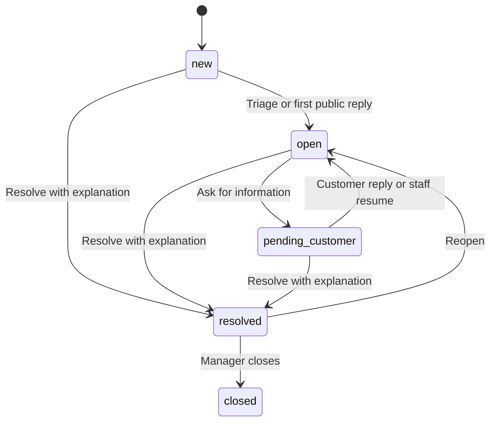
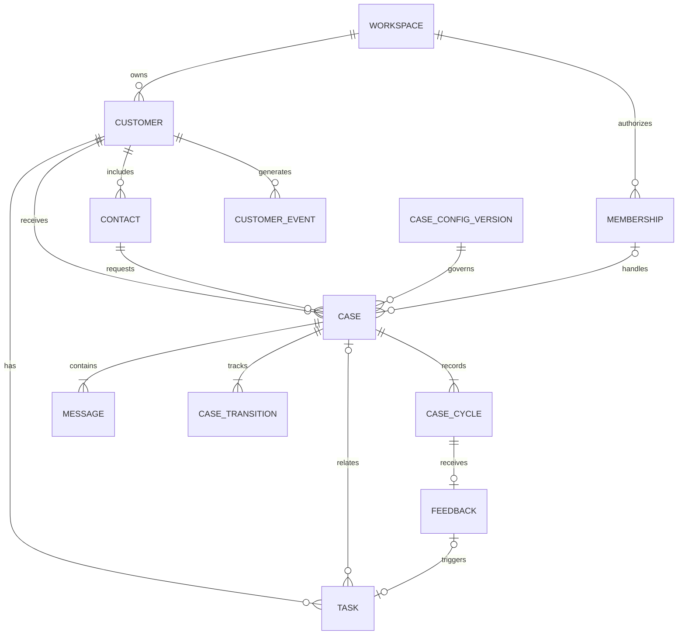
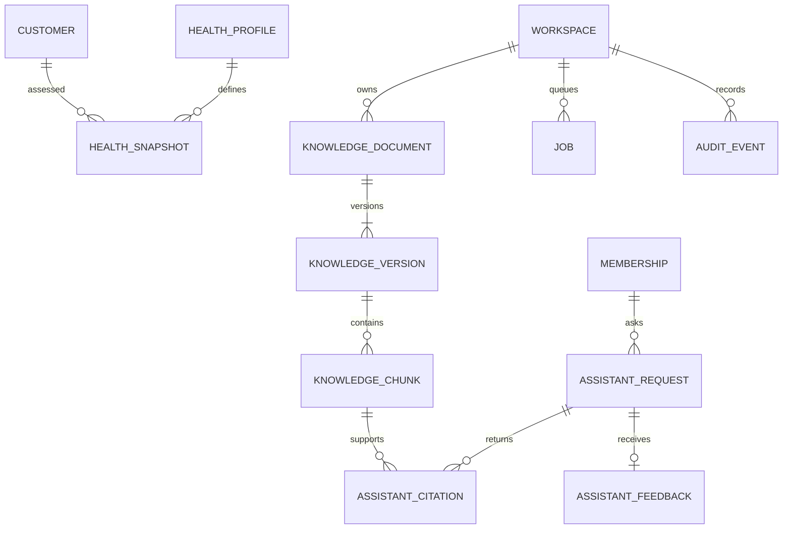
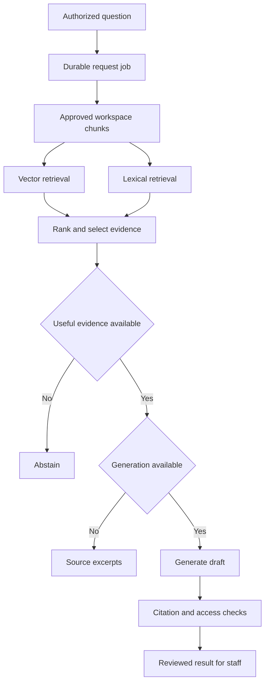
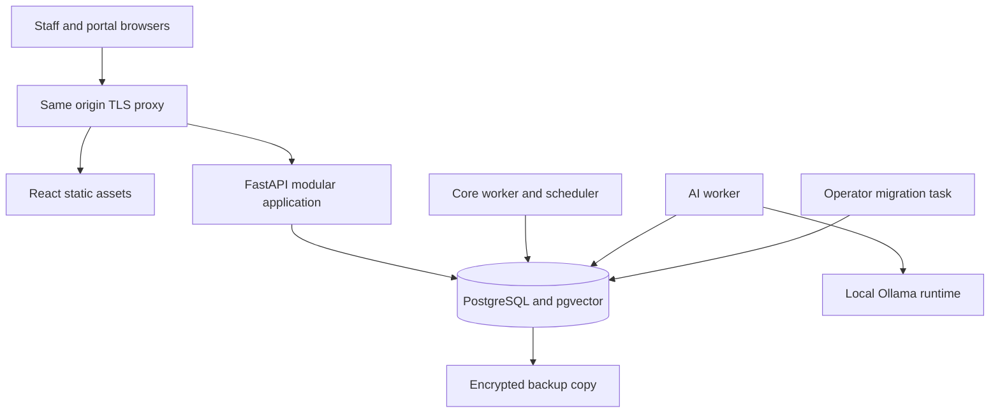

# Atlas CX Product and Engineering Specification

Version 1.0 · 8 November 2026 · Planning baseline for implementation

Atlas CX is a unified customer operations and service intelligence platform for small teams. It connects customer records, support conversations, service cases, product events, knowledge, and follow-up work. Its purpose is to help a team understand a customer’s situation and complete the next useful action without reconstructing the history across separate tools.

This document defines an implementable portfolio MVP using React, TypeScript, Vite, FastAPI, Python, PostgreSQL, pgvector, SQLAlchemy, Alembic, Docker, and GitHub Actions. It is a design specification, not a claim that the application, integrations, research interviews, or measured results already exist. No implementation or repository change is part of this deliverable.

The central decision is to build one modular monolith with a shared case engine and a small set of versioned configuration options. The first release covers all nine requested feature areas at a deliberately limited depth. It supports real portal-to-agent workflows, rather than displaying disconnected dashboard examples.

## 1 Reading guide and decision status

The word **must** indicates required MVP behavior. **Default** identifies the value to implement unless configuration explicitly overrides it. **Later** means excluded from MVP. Numbers described as targets, budgets, limits, or estimates are design choices, not measured performance or research findings.

| Section | Implementation purpose |
| --- | --- |
| 2–4 | Evidence, product requirements, personas, and scope |
| 5–7 | Configuration, state transitions, workflows, and screen behavior |
| 8–10 | Permissions, database schema, ER diagrams, and API contract |
| 11–13 | RAG, health calculations, and analytics definitions |
| 14–16 | Application structure, deployment, and operations |
| 17–19 | Tests, acceptance criteria, and implementation roadmap |
| 20–21 | Decision log, handoff checklist, and sources |

### 1.1 Fixed decisions

- A workspace is the tenant boundary. A customer is a person or business served by that workspace; it is never the tenant itself.
- Staff share workspace-wide operational visibility. Teams determine routing and assignment, not private access boundaries in MVP.
- Every support conversation belongs to exactly one case. The inbox and case list are two views of the same work.
- Portal users see only cases they personally requested. Sharing a customer account does not grant access to other contacts’ cases.
- Cases use fixed semantic states, configurable labels and categories, typed custom fields, and versioned settings. No arbitrary workflow scripting.
- Health is a transparent rules-based indicator. It is not churn prediction, a diagnosis, or an ML probability.
- RAG searches approved workspace knowledge only. It cannot execute SQL, change records, contact customers, or automatically send a generated response.
- The app works without a generation provider. Search returns source excerpts; the UI explicitly labels this mode.
- The reference deployment is a same-origin web application with a containerized API, background workers, and PostgreSQL. A local Docker environment is mandatory.
- MVP supports English content and a configurable IANA timezone, defaulting to Asia/Kolkata. Stored timestamps are UTC.

### 1.2 Explicit assumptions to validate

The initial design assumes a team of roughly 3–20 staff, a manager who can maintain knowledge, and a willingness to use a portal or enter requests manually. These are planning assumptions. The application should be tested with a synthetic workload of 10 workspaces, 10,000 customers, 50,000 cases, 250,000 messages, 500,000 events, and 10,000 knowledge chunks across the installation. These are test fixtures, not promised capacity.

SaaS and subscription support are the first demonstration scenario because product activity, account records, and recurring service questions fit the requested features. Service businesses, e-commerce, and educational platforms receive presets using the same engine. Product-market fit for any segment remains unproven.

## 2 Published problem evidence

### 2.1 Method and limits

This is desk research using published first-party organizational material. It uses government grievance guidance, ombudsman investigations, and complaint-handling guidance as documented operational problem statements. It does not present them as interviews with Atlas CX customers or as verified Smart India Hackathon problem IDs. Their findings explain useful service-management patterns; they do not establish the frequency of these problems in Indian SMEs or demonstrate demand for this product.

Sources were checked on 8 November 2026. The references in section 21 include direct links. Each evidence row separates the published observation from the proposed design response.

| ID | Published evidence | Implication for Atlas CX, an inference | Requirement |
| --- | --- | --- | --- |
| E1 | DARPG’s August 2024 grievance guidance, summarized by PIB, calls for a common intake platform, responsible officers, monitoring of pending work, feedback analysis, escalation, and recorded action taken. [S1] | Intake alone is insufficient; cases need accountable ownership, visible age, and a resolution record. Government-specific time limits are not imported as SME defaults. | FR2, FR3, FR7, FR8 |
| E2 | The Housing Ombudsman’s May 2023 report describes how weaknesses in information management can turn ordinary service requests into prolonged complaints. [S2] | A shared customer timeline should connect requests, conversations, and completed actions. Better software still depends on staff entering useful records. | FR1, FR4 |
| E3 | Its May 2024 report describes Lewisham Council repair records that did not establish clearly which work occurred or when, contributing to confusion and prolonged handling. [S3] | Status changes need a history, resolution needs an explanation, and follow-up tasks need completion evidence. This is a service-delivery example, not a SaaS customer study. | FR2, FR7 |
| E4 | Its January 2025 follow-up identifies poor-quality information and databases that do not communicate as continuing barriers reported by participating landlords. [S4] | Explicit customer identifiers, duplicate handling, and controlled event ingestion matter more than a large catalogue of unimplemented integrations. | FR1, FR4 |
| E5 | The Parliamentary and Health Service Ombudsman’s guidance calls for recording complaints, identifying recurring themes, and creating action plans from learning. [S5] | Category trends and negative feedback should lead to an assigned task with a due date. Counts without a follow-up workflow are incomplete. | FR7, FR8 |

### 2.2 Product problem statements

1. **Fragmented context:** an agent cannot quickly establish the customer, prior requests, and recent activity relevant to a new issue.
2. **Unowned work:** requests have a status but no clear person responsible for the next action.
3. **Unreliable closure:** a request is marked complete without an explanation or a record of what was done.
4. **Hard-to-find knowledge:** staff search disconnected policy notes and may use an outdated answer.
5. **Feedback without action:** complaints are counted but recurring failures do not produce tracked improvements.

The product hypothesis is that a connected case workflow with a visible customer history and approved knowledge will reduce reconstruction effort and make incomplete work easier to notice. No reduction percentage is claimed.

### 2.3 Validation plan before a real pilot

Recruit approximately five to eight staff across two or three small organizations, with permission to observe anonymized work. Ask them to reconstruct a recent request, show how they find policies, and explain what makes a case complete. Do not ask them to share customer credentials or production exports.

Use the prototype to test: find an unresolved request; identify its owner; answer from an approved article; distinguish a private note from a customer reply; reopen a case; and identify a recurring issue. Record task success, time-on-task, errors, and comments with consent. Treat the sample as qualitative. Revise labels and defaults from observed confusion; do not claim statistical improvements from this small study.

## 3 Product requirements and outcomes

### 3.1 Product boundary

Atlas CX owns operational customer context and service work. It does not replace billing, fulfilment, learning management, identity providers, or a full sales CRM. External references such as order IDs and subscription IDs are stored as context, not treated as proof of a successful refund, delivery, or payment.

| ID | Requirement | User outcome |
| --- | --- | --- |
| FR1 | Customer 360 and lightweight CRM | Find a customer, contacts, owner, lifecycle, cases, events, tasks, and health in one place. |
| FR2 | Configurable case management | Apply the appropriate category, required fields, owner, priority, and controlled state changes. |
| FR3 | Support inbox | Read and reply to portal conversations; keep private notes visibly separate. |
| FR4 | Activity and event tracking | Ingest validated product events and show a traceable customer timeline. |
| FR5 | RAG knowledge assistant | Find approved information and draft a sourced answer that staff review. |
| FR6 | Customer health indicators | Understand which observable conditions need attention and why. |
| FR7 | Feedback and follow-up tasks | Turn customer dissatisfaction or recurring problems into assigned work. |
| FR8 | Operational analytics | Inspect workload, response and resolution times, overdue work, category trends, and feedback. |
| FR9 | Customer-facing portal | Submit a request, read public replies, reply, request reopening, and rate a resolution. |

### 3.2 Product success measurement

Collect baselines during a pilot before setting improvement goals. Useful measures are median time to locate relevant context, share of active cases with an owner, first-response time, resolution time, reopen rate, and completed follow-up tasks. A lower resolution time is not success if reopen rates or dissatisfaction increase.

Portfolio completion is assessed by repeatable workflows, meaningful tests, traceable data, and an honest evaluation report. Synthetic customer data must be labelled. Demonstration outcomes cannot be described as real business impact.

### 3.3 Nonfunctional requirements

| Area | Required behavior or proposed verification target |
| --- | --- |
| Isolation | Zero cross-workspace or cross-contact disclosures in the authorization suite. |
| Consistency | A business mutation, its audit entry, and any queued work commit together. |
| Ordinary API latency | Proposed target: p95 under 750 ms for list/detail requests at 20 concurrent users on the documented test host; excludes cold starts and AI. Record actual results. |
| Interactive experience | Loading feedback appears immediately; ordinary pages remain usable while AI or reports are pending. |
| Accessibility | Target WCAG 2.2 AA; keyboard access, labelled controls, visible focus, contrast, reduced motion, and screen-reader checks are release requirements. This is not a certification claim. |
| Recovery | Reference target: daily backup, at most 24 hours of data loss, restoration within four hours; verify by a timed restore rehearsal. |
| Observability | Request IDs, redacted structured logs, worker heartbeat, failure counts, migration version, and readiness checks. |
| Security | Server-enforced permissions, scoped database access, secure sessions, input validation, safe rendering, and rate limits. |
| Reproducibility | Locked dependencies, versioned migrations, deterministic fixture generation, and pinned container/model artifacts at implementation time. |

## 4 Personas and release scope

### 4.1 Working personas

These are role hypotheses derived from the intended workflow, not interviewed people. Names, ages, biographies, and fabricated quotations are intentionally omitted.

| Role | Primary job | Common difficulty to test | Main screens |
| --- | --- | --- | --- |
| Workspace administrator | Set up staff, categories, routing, and knowledge policy | Inconsistent configuration or accidental access | Settings, Members, Knowledge |
| Operations manager | Allocate work and prevent unresolved requests from being forgotten | Unassigned, overdue, or recurring cases | Overview, Cases, Analytics, Tasks |
| Support agent | Understand and resolve a customer request | Missing context and uncertainty about policy | Inbox, Customer 360, Assistant |
| Account owner | Notice customer difficulties and arrange a follow-up | Activity and complaints are considered separately | Customers, Health, Tasks |
| Read-only stakeholder | Review service activity without altering records | Numbers lack definitions or context | Analytics, Customers, Cases |
| Customer contact | Request help and understand progress | No clear status or visible response | Portal |

Account owner is a responsibility assigned to a staff member, not a separate permission role.

### 4.2 MVP depth across all requested features

| Feature | MVP | Later |
| --- | --- | --- |
| Customer 360 | Customer records, contacts, owner, lifecycle, tags, searchable timeline; validated CSV customer import | Deals, marketing automation, deduplication merge wizard |
| Cases | Categories, priorities, fixed semantic states, assignment, typed custom fields, response targets, history | Arbitrary state graphs, visual automation builder, business calendars |
| Inbox | Portal intake, manual logged requests, public replies, internal notes, unread state | Gmail, Outlook, WhatsApp, voice, social channels, live chat |
| Events | Authenticated ingestion API, idempotency, external customer IDs, event definitions | SDKs, streaming bus, automatic third-party connectors |
| RAG | Approved English Markdown/plain-text knowledge, versioning, hybrid retrieval, cited drafts, abstention | OCR, website crawling, connector ingestion, multilingual evaluation, autonomous actions |
| Health | Explainable rule components, missing-data handling, versioned daily snapshots | Learned churn scores or automated account actions |
| Tasks and feedback | Manual tasks, resolution rating, one deduplicated low-rating follow-up task | Campaigns and external reminders |
| Analytics | Defined operational metrics, filters, CSV exports | Warehouse, arbitrary report builder, predictive analytics |
| Portal | Provisioned contact login, own cases, public messages, feedback and reopen action | Public signup, contact-to-contact sharing, payments, public RAG chat |

### 4.3 Explicit exclusions

No email delivery or receipt is implied by the inbox. Public replies are visible in the authenticated portal. Manually logged phone/email requests are labelled with that origin but are not connected channels. There are no real payment, shipping, LMS, CRM, or messaging integrations in MVP.

Also excluded: mobile apps, attachment uploads, ticket merging, multiple conversations per case, service contracts, legally binding appeal adjudication, automated refunds, arbitrary custom entities, per-team data secrecy, full-text search across private notes from the portal, and claims of legal compliance. Organizations needing those features must not be described as supported pilots without additional work.

## 5 Configurable core platform

### 5.1 Configuration model

A workspace selects a starter preset. The preset copies ordinary configuration records; it does not install a separate application or choose a different code path. Subsequent changes affect that workspace only.

Workspace configuration consists of category labels, default routing team, four priority target pairs, custom case fields, and a health profile. State keys and transition rules are fixed. Labels may change, but their semantic meaning may not. Configuration has draft and published versions; a case stores the published case-configuration version used when created. Existing cases never silently adopt changed validation rules or targets.

| Preset | Customer meaning | Example categories | Example case fields | Meaningful activity examples |
| --- | --- | --- | --- | --- |
| SaaS | Subscriber organization or individual | Access, Billing question, Product issue | plan_name, environment, subscription_ref | feature_used, session_completed |
| Service business | Client | Appointment, Work request, Service complaint | service_ref, appointment_date | service_completed; engagement disabled by default |
| E-commerce | Buyer | Delivery question, Return request, Product issue | order_ref, item_ref | order_placed; engagement disabled by default |
| Education | Learner or institution | Course access, Content query, Fee question | course_ref, enrollment_ref | lesson_completed |
| Subscription business | Member | Renewal question, Access, Cancellation request | subscription_ref, renewal_date | subscription_used |

Names above are seed examples. No payment status or delivery outcome is inferred from a reference string. Educational demos use fictional adult learners; handling real minor data is outside the pilot scope.

### 5.2 Bounded custom fields

Support string, integer, decimal, boolean, date, and single-select. Each field has a stable key, label, type, required-on-create flag, required-on-resolve flag, portal-visible flag, portal-editable-on-create flag, and allowed values or numeric bounds. Maximum 20 fields per published configuration. Unknown keys are rejected. Null clears an optional value; it cannot satisfy a required field. Date means ISO calendar date, not a timestamp.

Only administrators publish configuration. Publishing validates field keys, unique options, all priority targets, valid routing teams, and that the portal can supply all required-on-create fields. A required-on-create field hidden from the portal must have an explicit configured default. Hidden internal fields are omitted from portal responses and never sent to the browser. Field type and option changes are permitted in new versions because old cases remain pinned to their old version.

### 5.3 State machine

Stable states: new, open, pending_customer, resolved, closed. New means received but not triaged; open means staff action is underway; pending_customer means staff has asked for information; resolved means staff has provided a resolution; closed means a manager has administratively finalized the record.

| Transition | Preconditions and effects |
| --- | --- |
| new → open | Assign an active staff member or retain the current assignee; unassigned opening is rejected. A first public staff reply also opens a new case and assigns the actor if unassigned. |
| open → pending_customer | Must include a public request-for-information message in the same operation. Pauses the resolution clock only. |
| pending_customer → open | Customer reply automatically resumes; staff resume requires a reason. |
| new/open/pending_customer → resolved | Active assignee required; required resolution fields valid; nonempty public resolution summary and resolution code required. Inserts a public message and records the resolution cycle. |
| resolved → open | Staff provides a reason or requester reopens with a message. Starts a new resolution cycle; previous metrics remain intact. |
| resolved → closed | Manager/admin only, with closure reason. Feedback stays visible. No automatic closure. |
| closed → any state | Disallowed. Create a new case with related_case_id pointing to the closed case. |

Customer messages on resolved cases must use the reopen operation; an ordinary message returns 409 with an explicit instruction. Closed cases reject messages and feedback creation. Submitted historical feedback remains readable. State is never writable through a generic patch. Mutations lock the case and check its version.

### 5.4 Targets and clock semantics

Default response/resolution targets, in elapsed minutes: urgent 60/480, high 240/1440, normal 480/2880, low 1440/5760. These are product defaults and are not derived from grievance regulations. They are operational targets, not contractual SLAs.

Both clocks begin at case creation. An automated acknowledgement, initial intake description, internal note, or manually logged past response does not satisfy first response. The first public staff message of kind reply, info_request, or resolution committed in Atlas CX does. First response never pauses and never resets on reopening.

The resolution clock pauses only in pending_customer. Store accumulated paused seconds and the current pause start. On resumption, add the elapsed pause and clear pause start. A case is overdue when active elapsed time strictly exceeds its target. While paused, show “Paused” and the remaining active time, not a misleading fixed deadline.

Every exit from pending_customer, including direct resolution, first settles that pause through the transition instant. Compute active elapsed seconds as elapsed since cycle opening minus accumulated pauses and any currently running pause. Clamp only numerical rounding noise, not actual invalid timestamps; all transition instants are server-generated and monotonic per case. Use the same clock service for UI target status, health, and analytics.

Each reopening starts a new resolution cycle with the same snapshotted resolution target and fresh paused duration. Metrics distinguish the initial response and per-cycle resolutions. Assignment, category, or priority edits do not reset clocks or targets in MVP. The UI warns that priority changes affect ordering, while the original target remains unchanged. Altering this rule later requires a separate target-change audit operation.

## 6 End-to-end workflows

### 6.1 Customer request to completed follow-up

1. A provisioned portal contact submits category, subject, description, and visible custom fields.
2. The server derives workspace, contact, and customer from the session. It creates the case, initial public message, first resolution cycle, and audit entry atomically. Routing sets the configured team; assignment remains empty.
3. An agent opens the Unassigned inbox, reviews Customer 360, and claims the case using version checking. Another agent attempting the same version receives a conflict.
4. The agent asks the assistant a policy question. It returns approved source excerpts and, if generation is available, a cited draft. The agent edits the draft and explicitly posts a public reply.
5. If more information is needed, the agent uses “Ask customer,” which posts a public message and transitions to pending_customer atomically.
6. The contact sees the reply in the portal and responds. The case resumes automatically and becomes unread for staff who have not read it.
7. The agent resolves with a public explanation and resolution code. The portal offers a rating for this resolution cycle.
8. A rating of 1 or 2 creates one follow-up task for that feedback record. The task belongs to the case assignee, falling back to the customer owner and then the configured manager.
9. The manager reviews the task and relevant category trends; completion records what action was taken. A low rating does not automatically reopen or change health history retroactively.

### 6.2 Product event to account follow-up

An authenticated integration sends an event with a registered event name, known external customer ID, event ID, and occurrence time. The API validates and stores it once. The event appears in the customer timeline. A daily health job evaluates meaningful activity and service signals. Staff inspect the component evidence and create a task if warranted. No outreach is sent automatically.

### 6.3 Knowledge maintenance

A manager drafts an article or uploads UTF-8 TXT/Markdown. An administrator or manager publishes the revision for indexing. The worker normalizes, chunks, and embeds it. Only a fully indexed revision can become active. Failure leaves the previous active revision available and shows a retriable error. Archiving removes the document from new retrieval immediately, including already queued questions at their final authorization check.

### 6.4 Reusable configuration demonstration

Create a SaaS workspace and a service-business workspace from different presets. Submit a product-access case in one and an appointment case in the other. Show different fields and routing with the same API resources, components, and state transitions. Verify that neither workspace can search, count, or cite records from the other.

## 7 UX specification

### 7.1 Information architecture

Staff navigation: Overview, Inbox, Cases, Customers, Tasks, Knowledge, Assistant, Analytics, Settings. The portal has Requests, New request, and Profile. Only permitted navigation items are shown, while backend authorization remains authoritative.

| Screen | Required content and actions |
| --- | --- |
| Overview | Unassigned cases, overdue active cycles, my pending tasks, recent negative feedback; each card opens a filtered list. |
| Inbox | Saved system views: Unassigned, Mine, Awaiting customer, Recently resolved; case list, conversation, customer context; unread per staff member. |
| Case detail | Subject, number, category, state, owner/team, priority, target state, public/private timeline, custom fields, history, tasks, resolution controls. |
| Customer list | Name, type, owner, lifecycle, health or Unknown, last meaningful activity; search/filter/sort and CSV import. |
| Customer 360 | Summary and contacts; timeline, cases, events, tasks, health component explanation. No invented revenue values. |
| Tasks | My tasks and all tasks, due date/status filters, completion evidence, links to customer/case/feedback. |
| Knowledge | Draft/indexing/active/failed/archive states, revision history, source preview, publish/retry actions. |
| Assistant | Question, pending status, answer or abstention, source cards, generation mode, feedback. Case context is limited to an optional case link; no automatic message ingestion. |
| Analytics | Period, category, team, metric definitions, denominators, last computed time, CSV export. |
| Settings | Workspace timezone, configuration versions, members, teams, event definitions, ingestion credentials, health profile, AI availability. |
| Portal request | Public messages and resolution only, status explanation, reply/reopen controls, rating, safe visible fields. |

### 7.2 Interaction rules

- Default composer mode is a public reply with a clearly visible “Visible to customer” label. Internal note uses a separate tab with a persistent “Staff only” label and distinct icon; never rely on color alone. Switching modes keeps separate drafts.
- Sending and state-changing buttons show pending state, prevent duplicate clicks, and keep drafts after errors. Do not optimistically display an unsaved message as delivered.
- “Use draft” copies an assistant answer into the composer; it never submits it. Public messages do not expose staff-only citation URLs automatically.
- Search lists debounce input; filters persist in URL parameters. Pagination uses a stable cursor. Selecting a result is keyboard accessible.
- Validation appears beside fields and in a focused summary. A 409 conflict preserves the draft and offers reload/reapply against the new version; no silent overwrite.
- Empty states explain the next action. Distinguish no data, no matching results, no permission, loading, provider unavailable, worker delayed, and server error.
- Use a restrained interface: warm neutral background, dark legible text, muted green for completed work, and amber/red with text for attention. Status controls and information density take precedence over decorative shapes.
- At 1280 px, inbox may use three columns; at 768 px, show list plus detail; at 390 px, use sequential list/detail/context views. Tables may scroll within a labelled region without causing page-wide overflow. Verify at 200% zoom.
- Charts have accessible tables. Tooltips are supplementary; all essential values are visible without hovering. Honor reduced-motion preferences.
- All destructive administrative actions explain consequences. Archive replaces routine deletion. Public demo data and search-only AI mode remain visibly labelled.

### 7.3 Demo narrative

The five-minute demonstration follows one fictional customer through a portal request, agent triage, sourced policy lookup, resolution, negative feedback, and follow-up task. Then show a duplicate event rejected safely, a second preset with different fields, and a cross-workspace access test. This demonstrates engineering decisions without claiming production adoption.

## 8 Identity and permission model

### 8.1 Authentication and provisioning

Use local email/password accounts and server-side sessions for MVP. Passwords are hashed with Argon2id using a maintained library and deployment-calibrated parameters. No password, session token, or invitation token is stored in plaintext. Session tokens are high-entropy random opaque values; store only their hashes. Do not put auth tokens in browser localStorage.

Login includes workspace slug and audience, either staff or portal. The server verifies the corresponding active membership or portal binding and stores that workspace and audience in the session. Changing workspaces requires a new authenticated session context; a request header cannot override it. A person may have multiple memberships, but every request has one active scope.

Use Secure, HttpOnly, SameSite=Lax cookies and a server-validated CSRF token on every state-changing browser request, plus Origin checking. Login and setup flows also enforce same-origin requests. Session idle expiry is 12 hours, absolute expiry seven days; regenerate the session after login and password change. Revocation and membership deactivation take effect on the next request. Password change revokes all existing sessions.

The initial administrator is created by an operator bootstrap procedure. Administrators create invitation/setup links for staff and portal contacts; this does not send email. A link is displayed once, expires in 24 hours, is single use, and is stored hashed. Administrators share it through an independently verified channel outside Atlas CX. For an existing global account, setup requires that account’s current password before adding access. New accounts set a password. Password recovery uses an operator-issued, single-use recovery link after an out-of-band identity check; public self-service recovery and email verification are later features. Never issue recovery links through ordinary tenant admins for a global user account.

At least one active administrator must remain per workspace. Deactivating a staff member requires selecting an active replacement for assigned active cases, incomplete tasks, customer ownership, and default routing/feedback manager references. Update these atomically and revoke access; historical authorship remains.

The replacement must satisfy every affected role/team constraint. If it does not, reject the whole operation with a list of visible conflicts so the administrator can adjust team membership or transfer those records first. Role demotion uses the same checks when it would make an existing responsibility invalid.

### 8.2 Permission matrix

Scope for staff is the active workspace. “Own” for the portal means requester_contact_id equals the session’s contact. Role checks occur in the service layer for every operation, including exports and polling endpoints.

| Capability | Admin | Manager | Agent | Viewer | Portal contact |
| --- | --- | --- | --- | --- | --- |
| Read customers, cases, notes, events | Yes | Yes | Yes | Yes | Own case public projection only |
| Create/edit customers and contacts | Yes | Yes | Yes | No | No |
| Import customers or archive customer | Yes | Yes | No | No | No |
| Create case and public reply | Yes | Yes | Yes | No | Own |
| Add internal note | Yes | Yes | Yes | No | No |
| Claim, assign, reprioritize, resolve | Yes | Yes | Yes | No | No |
| Reopen resolved case | Yes | Yes | Yes | No | Own, with message |
| Close resolved case | Yes | Yes | No | No | No |
| Create/update tasks | Yes | Yes | Yes | No | No |
| Submit resolution rating | No | No | No | No | Own, once per cycle |
| Draft/publish/archive knowledge | Yes | Yes | No | No | No |
| Search knowledge, ask assistant | Yes | Yes | Yes | Read approved knowledge only | No |
| Read assistant history | Own requests | Own requests | Own requests | No | No |
| View analytics | Yes | Yes | Yes | Yes | No |
| Export operational data | Yes | Yes | No | No | No |
| Manage members, keys, configuration | Yes | No | No | No | No |
| Inspect audit and job failures | Yes | Yes | No | No | No |

Agents can update any workspace case or task. This is an intentional small-team policy. Assignment indicates responsibility and does not make a record private. UI text must not imply team confidentiality. All staff roles can see customer PII and internal notes; grant Viewer only to trusted internal users.

Eligible operational owners and assignees are active admin, manager, or agent memberships; viewers and pending memberships cannot own active work. When a case has a team, its assignee must belong to that team. A claim by a nonmember is rejected until the team is changed or membership is updated through an authorized operation. The configured fallback manager must be active admin/manager.

### 8.3 Database and object authorization

Every tenant-owned table has workspace_id. Enforce PostgreSQL row-level security with a transaction-local verified workspace context, both read predicates and write checks. The application role is neither a table owner, superuser, nor BYPASSRLS role. Use FORCE ROW LEVEL SECURITY on tenant tables and a separate migration role. PostgreSQL documents these bypass conditions; enabling a policy alone is not sufficient. [T1]

Every foreign key between tenant tables includes workspace_id. A guessed record ID must not cross a workspace boundary. For portal case/message/feedback access, add requester ownership and public-visibility checks in scoped repositories and applicable row policies. Staff and portal use separate response schemas so hidden fields cannot leak through serialization.

The identity tables used before workspace establishment have narrowly scoped authentication repositories; no generic user listing is exposed. Workers derive tenant context from a trusted queued job record, then open a tenant-scoped transaction. A narrowly granted scheduler/queue role may enumerate workspace IDs and lease jobs but cannot read business tables. It does not share the API’s HTTP surface.

Return 404 for a missing or inaccessible object ID, 403 for a prohibited operation on an otherwise visible object, and 401 for no valid session. Validate role and ownership again when completing long jobs or returning their results. Never trust an ID merely because it appeared in an earlier authorized page.

## 9 Database schema and integrity rules

### 9.1 Conventions

Use UUID primary IDs unless a sequence is explicitly named. Tenant tables have workspace_id, created_at, and where mutable, updated_at and version (positive integer). All timestamps are timestamptz; dates are date; amounts are not modeled in MVP. Strings have the limits specified in the API contracts. Required fields are non-null unless marked optional below. FKs are restrictive by default. No destructive cascade from customers, users, cases, or knowledge documents through operational history.

All tenant entities referenced by other tables expose a unique pair (workspace_id, id). Tables that reference a case plus its customer enforce a composite relationship or derive the customer through the case; they do not accept inconsistent independent values. JSONB is reserved for validated configuration, custom values, safe event properties, and immutable calculation details. Core ownership, status, relationships, and time fields remain relational.

Notation: UQ means unique constraint; FK means foreign key; ? means nullable. Common columns above are omitted below for readability. Enumerations use validated text plus database CHECK constraints. Every added enum value requires a migration and contract update.

### 9.2 Identity and configuration tables

| Table | Columns beyond conventions | Constraints and purpose |
| --- | --- | --- |
| workspaces | id, slug, name, timezone, active_case_config_id?, active_health_profile_id?, feedback_manager_member_id?, demo_expires_at?, is_demo, archived_at? | Global unique slug. Active config/profile FKs must belong to this workspace. Provisioning is incomplete until a config, profile, and fallback manager exist. |
| users | id, normalized_email, display_name, password_hash?, disabled_at?, created_at, updated_at | Global UQ normalized_email. No workspace_id. Pending accounts have no password until setup. |
| memberships | user_id, role, active | UQ(workspace_id,user_id); role in admin/manager/agent/viewer. IDs are used for staff ownership. |
| teams | name, archived_at? | UQ(workspace_id,lower(name)); archived teams cannot receive new assignments. |
| team_members | team_id, member_id | Composite PK(workspace_id,team_id,member_id); both references remain in workspace. |
| portal_bindings | user_id, contact_id, active | UQ(workspace_id,user_id); UQ(workspace_id,contact_id). Exactly one contact identity per portal user per workspace. |
| sessions | id, token_hash, user_id, workspace_id, audience, csrf_secret_hash, expires_at, absolute_expires_at, last_seen_at, revoked_at? | Global UQ token_hash. Global identity table with constrained auth-only access. Session membership/binding is checked on every request. |
| setup_tokens | id, token_hash, workspace_id?, user_id, membership_id?, portal_binding_id?, purpose, expires_at, used_at? | Purpose staff_setup/portal_setup/recovery. One target for setup; recovery has no tenant-admin issuance path. Consume token and activate access atomically. |
| case_config_versions | number, status, definition_json, published_at?, created_by_member_id | UQ(workspace_id,number); status draft/published. Published payload immutable. Contains categories, priority targets, field definitions, and state labels as described in section 5. |
| health_profiles | number, status, definition_json, published_at?, created_by_member_id | UQ(workspace_id,number); immutable after publication. A later profile changes future snapshots only. |
| event_definitions | key, label, allowed_properties_json, counts_as_activity, enabled | UQ(workspace_id,key); key immutable. Property values are scalar and validated. No arbitrary nested objects. |
| api_credentials | name, token_prefix, token_hash, scope, revoked_at?, last_used_at? | UQ token_hash; scope events:write only in MVP. Secret displayed once. Workspace and scope derived from the key. |

### 9.3 Customer and operational tables

| Table | Columns beyond conventions | Constraints and purpose |
| --- | --- | --- |
| customers | external_id?, kind, name, lifecycle, owner_member_id?, tags[], activity_expected, tracking_started_at?, archived_at? | kind person/business; lifecycle prospect/active/inactive. Partial UQ(workspace_id,external_id) when present. No email-based automatic merging. |
| contacts | customer_id, name, normalized_email, phone?, archived_at? | UQ(workspace_id,normalized_email). If an email already belongs to another customer, reject and require staff review. UQ(workspace_id,customer_id,id) supports requester/customer consistency. |
| cases | number, customer_id, requester_contact_id, config_version_id, category_key, subject, source, state, priority, team_id?, assignee_member_id?, custom_values, related_case_id?, first_response_at?, first_response_target_seconds, resolution_target_seconds, last_public_message_seq?, last_message_at, current_cycle_number | UQ(workspace_id,number). FK requester must belong to customer. source portal/manual_phone/manual_email/manual_other. Case number allocated under a per-workspace counter lock; UUID remains API identity. |
| case_cycles | case_id, cycle_number, opened_at, target_seconds, paused_seconds, pause_started_at?, resolved_at?, resolved_by_member_id?, resolution_code?, resolution_summary? | UQ(workspace_id,case_id,cycle_number); one unfinished cycle per case. paused_seconds ≥0; resolved_at ≥opened_at. Snapshot target at cycle creation. |
| messages | case_id, sequence, author_user_id?, author_kind, visibility, body, message_kind | Global monotonic sequence for cursor order; UQ(case_id,sequence). author_kind staff/contact/system; visibility public/internal; kind initial/reply/note/resolution/info_request/reopen. Append-only. System markers are not counted as staff responses. |
| case_read_markers | case_id, member_id, last_read_sequence | UQ(workspace_id,case_id,member_id). Marker monotonically increases only up to a message the caller can read. |
| case_transitions | case_id, cycle_number, from_state?, to_state, actor_user_id?, reason?, occurred_at | Append-only. Initial creation has null from_state. Transition and case update happen in one transaction. |
| tasks | customer_id, case_id?, feedback_id?, title, description?, assignee_member_id, due_at, state, completed_at?, completed_by_member_id?, completion_note?, created_by_member_id? | state open/in_progress/completed/cancelled. Partial UQ(workspace_id,feedback_id) when present; case must belong to customer. Completion requires note and server-set actor. |
| feedback | case_id, cycle_number, requester_contact_id, rating, comment? | UQ(workspace_id,case_id,cycle_number); rating integer 1–5. FK cycle must be resolved and requester must match case, checked transactionally. Immutable. |
| customer_events | customer_id, event_definition_id, external_event_id, occurred_at, received_at, safe_properties, payload_hash, activity_flag_snapshot | UQ(workspace_id,external_event_id). Append-only. Preserve the event definition’s activity meaning at ingestion so later edits do not rewrite historical activity. |
| customer_imports | submitted_by_member_id, status, input_hash, normalized_rows_json, row_results_json, expires_at, completed_at? | status validated/committed/failed/expired. Short-lived staged input, maximum 1,000 rows. Preview and commit are separate; committed import cannot be applied again. |
| workspace_counters | next_case_number | One row per workspace; atomic allocation. Gaps are acceptable, duplicate numbers are not. |

Description is the initial public message rather than a second mutable body on cases. Portal-visible resolution summaries are part of public history. Internal notes are never copied into a portal message automatically.

### 9.4 Knowledge, intelligence, and infrastructure tables

| Table | Columns beyond conventions | Constraints and purpose |
| --- | --- | --- |
| knowledge_documents | title, active_version_id?, pending_version_id?, archived_at?, created_by_member_id | Document identity survives revisions. Pointers reference revisions of this document in this workspace; pending_version_id records latest publication intent. Staff-only audience for every document in MVP. |
| knowledge_versions | document_id, revision_number, source_kind, source_name?, content_text, content_sha256, status, embedding_model_revision?, error_code?, published_by_member_id?, indexed_at? | UQ(workspace_id,document_id,revision_number); status draft/queued/indexing/ready/failed. source_kind pasted/txt/markdown. Published text immutable; new edits create a revision. |
| knowledge_chunks | version_id, ordinal, heading_path, start_offset, end_offset, content, token_count, embedding vector(384), search_tsvector | UQ(workspace_id,version_id,ordinal). Offsets index the canonical revision text; exact quoting is reproducible. Chunk FK includes tenant. |
| assistant_requests | requested_by_member_id, question, case_id?, state, answer_text?, mode?, abstention_reason?, model_id?, prompt_version, retrieval_version, error_code?, completed_at? | state queued/running/completed/failed; mode generated/sources_only/abstained. History visible only to requesting member. No shared cross-user answer cache. |
| assistant_citations | request_id, label, document_id, version_id, chunk_id, excerpt, rank | UQ(workspace_id,request_id,label). Excerpt is a snapshot; access is rechecked against current document/archive status before returning historical content. |
| assistant_feedback | request_id, member_id, helpful, reason? | UQ(workspace_id,request_id,member_id); requester only. Editable by same requester. |
| health_snapshots | customer_id, profile_id, as_of, score?, band, components_json, coverage, computed_at | UQ(workspace_id,customer_id,profile_id,as_of). score 0–100 or null; band healthy/watch/at_risk/unknown. Immutable. |
| audit_events | sequence, actor_user_id?, actor_kind, action, entity_type, entity_id?, changed_fields, reason?, request_id, occurred_at | Append-only. Record safe identifiers and changed keys, not full messages, passwords, tokens, or document bodies. No general update/delete grant for app role. |
| jobs | kind, payload_json, result_refs_json?, dedupe_key, status, available_at, attempts, locked_by?, attempt_token?, lease_until?, heartbeat_at?, last_error_code?, finished_at? | UQ(workspace_id,dedupe_key); status queued/running/succeeded/failed. Each lease gets a new random attempt_token. Payload contains trusted IDs, not executable instructions; result_refs_json stores committed result IDs and calculation as_of, never sensitive bodies. |
| idempotency_records | principal_key, route_key, key, request_hash, resource_type?, resource_id?, response_status, expires_at | UQ(workspace_id,principal_key,route_key,key). For browser mutations; no cached sensitive full response body. |
| rate_limit_buckets | principal_key, operation, window_start, request_count | UQ(workspace_id,principal_key,operation,window_start). Atomic increments; operational TTL cleanup. Global login buckets use a separate auth namespace. |

### 9.5 ER diagrams

Operational relationships are split from knowledge relationships for readability. Tenant composite keys and common columns apply even where the diagram omits them.

### 9.6 Indexes and transactions

Required indexes: cases(workspace_id,state,priority,created_at,id); cases(workspace_id,assignee_member_id,state); cases(workspace_id,customer_id,created_at,id); messages(workspace_id,case_id,sequence); customer_events(workspace_id,customer_id,occurred_at,id); tasks(workspace_id,assignee_member_id,state,due_at); customers(workspace_id,external_id); health_snapshots(workspace_id,customer_id,as_of descending); jobs(status,available_at,lease_until); and GIN indexes on knowledge chunk search vectors and customer/case search vectors. Add case-cycle lookup and transition-time indexes needed by analytics. Do not index every JSON field preemptively.

Start with exact cosine vector search restricted to the workspace and active document revisions. pgvector supports exact search by default. Approximate indexes are deferred until measurements justify them; filtered approximate search needs separate recall testing. [T2]

Use READ COMMITTED with row locks for claim, transition, resolution, feedback, setup-token consumption, and configuration publication. Use optimistic version checks for user edits. Import commits use one transaction after revalidating references and uniqueness. Catch expected uniqueness conflicts and return domain-specific errors without exposing SQL or tenant existence.

Use one short transaction to enqueue long work. Do not hold a database transaction open while calling a generation service. Knowledge indexing writes a complete staged revision and atomically switches active_version_id only if that revision is still the document’s latest publication intent. Archive cancels activation. A slower earlier job must not overwrite a newer published revision.

The customer timeline is a read projection joining messages, transitions, events, tasks, and feedback. It is not another authoritative event store. Use occurred_at plus kind and UUID/sequence as stable tie-breakers, and enforce the same visibility filters as each source.

## 10 API contract

### 10.1 Common protocol

Base path: /api/v1. JSON is UTF-8. The implementation must generate OpenAPI from validated request/response schemas and generate the TypeScript client from that contract. The tables below are the normative endpoint design; changing a business behavior requires updating this specification and its acceptance tests.

Resource responses contain data and meta.request_id. Lists contain data as an array plus meta.next_cursor and meta.has_more. Detail responses expose an ETag equal to the resource version. Datetimes use RFC 3339 UTC with Z; clients render in the workspace timezone. IDs are UUID strings except human-readable case numbers and opaque cursors. Nullable response fields are explicitly null; unknown response fields must not appear through ORM serialization.

List limit defaults to 25, maximum 100. Cursors are signed, opaque, and bound to workspace, resource, filters, and sort. A cursor from another scope is rejected. Default order is created_at descending then id descending; message order is sequence ascending. Supported alternative ordering is limited to the explicit list-screen fields in this section. Search q is limited to 200 characters. Filters use AND, with comma-separated values providing OR within one field. Do not expose arbitrary database column sorting or SQL expressions.

For all updates to versioned resources, require If-Match. Missing precondition returns 428; stale version returns 409 with code version_conflict and the current visible version. Case message and transition endpoints also require the current case ETag and advance its version. A client fetches a new ETag after a conflict; blind retries are forbidden.

Require Idempotency-Key for case creation, messages, transitions, feedback, task creation, assistant questions, import commit, and publication commands. Store 24 hours of replay metadata scoped to principal and normalized route. Within that window, identical canonical payloads return the original status and current authorized resource projection without a second mutation. Different payload with the same key returns 409 idempotency_conflict. Reauthorization occurs before replay; idempotency replay is checked before stale-version rejection. Event IDs and one-feedback-per-cycle constraints provide longer-lived deduplication.

Errors use application/problem+json with type, title, status, code, detail, instance, request_id, and optional field_errors containing path/code/message. No stack traces or SQL. Standard statuses: 400 malformed syntax/cursor; 401 unauthenticated; 403 disallowed capability; 404 inaccessible/missing object; 409 state/duplicate/version conflict; 413 too large; 415 unsupported content; 422 invalid fields; 428 missing If-Match; 429 rate limit with Retry-After; 503 unavailable dependency. Validation must not reveal that a conflicting email or ID exists in another workspace.

Create returns 201 with Location; immediate commands return 200; accepted durable work returns 202 with resource and polling URL; logout returns 204. Archive and role changes return the updated resource. Collection counts exposed to the portal are computed only from the caller’s accessible records.

### 10.2 Shared DTO definitions

The following are data contracts, not implementation code. “Input” lists accepted fields; extra fields are rejected. PATCH supports only the named mutable fields, requires at least one field, distinguishes omitted from null, and does not accept server-owned fields.

| DTO | Input and validation | Output additions |
| --- | --- | --- |
| CustomerCreate | name 1–160; kind person/business; lifecycle default active; external_id optional 1–120; owner_member_id optional; tags up to 20 unique strings of 1–40; activity_expected boolean default preset; tracking_started_at optional | id, version, timestamps, archived_at, latest_health summary, last_meaningful_activity_at |
| CustomerPatch | name, lifecycle, owner_member_id, tags, activity_expected, tracking_started_at; external_id only if currently null; kind immutable | Customer projection; external_id cannot be reassigned through PATCH |
| ContactCreate/Patch | customer_id required on create and immutable; name 1–120; email valid up to 254; phone optional up to 32 | id, version, timestamps, portal_enabled. Email on a portal-bound contact cannot change in MVP; use an operator identity procedure later. |
| CaseCreateStaff | customer_id, requester_contact_id, category_key, subject 1–200, description 1–10000, priority default normal, source manual_phone/manual_email/manual_other, team_id?, assignee_member_id?, custom_values default empty, related_case_id? | CaseDetail, initial message, current cycle; config and clock targets assigned by server |
| CaseCreatePortal | category_key, subject, description, portal-editable custom_values, related_case_id? | PortalCaseDetail; priority normal and routing from config; related case must be owned by same requester |
| CasePatch | category_key from pinned config, priority, team_id?, assignee_member_id?, custom_values; subject immutable | Updated CaseDetail; active assignee must be a team member when team is set; nullable assignee allowed only while state new |
| CaseDetail | No direct input | id, number, version, customer/contact summaries, config_version_id, category, state, priority, source, team/assignee, custom_values, created_at, first_response_at, first_response_target_at, current_cycle, target_status, related_case_id |
| PortalCaseDetail | No direct input | id, number, version, subject, category label, semantic state and public label, created_at, public custom values, latest public resolution, can_reply, can_reopen, can_rate, current_cycle_number. No internal owner data, health, task, private note, or target policy. |
| MessageCreate | body 1–10000, visibility public/internal for staff; portal always public | id, sequence, body, author display, author_kind, visibility, message_kind, created_at, updated_case_version |
| CaseTransition | action triage/ask_customer/resume/resolve/reopen/close; action-specific fields below | Updated case and resulting transition/message IDs |
| TaskCreate/Patch | customer_id required and immutable; case_id? same customer and immutable; title 1–200; description up to 4000; assignee_member_id; due_at; state on PATCH; completion_note 1–2000 when completing | id, version, feedback_id?, state, completed_at, timestamps. New tasks default open. |
| ResolutionFeedback | rating integer 1–5, comment optional up to 2000; cycle number in path | id, cycle_number, rating, comment, created_at; no internal follow-up task details in portal response |
| EventBatch | events array 1–100; each external_event_id 1–120, customer_external_id, event_name, occurred_at, properties default empty | received_count, inserted_count, duplicate_count, IDs in input order |
| KnowledgeDraft | document title 1–200 on new document; content_text 1–200000; source_kind pasted/txt/markdown; source_name optional 1–200 | document_id, version_id, revision_number, revision status, content hash, active_version_id, version for ETag |
| AssistantQuestion | question 1–2000, case_id optional and authorized; no client-provided chunks, instructions, or model URL | request_id, state, mode?, answer_text?, abstention_reason?, sources[], model_id?, completed_at? |
| AssistantSource | Server-owned | citation label, document/version/chunk IDs, title, heading_path, excerpt, authorized internal source URL, rank |

Transition fields: triage requires assignee_member_id if none exists; ask_customer requires message; resume requires reason; resolve requires resolution_summary, resolution_code and optional custom_values update; reopen requires reason for staff or message for portal; close requires reason. Resolution codes are answered, fixed, fulfilled, declined, duplicate, or other. Duplicate requires related_case_id; it does not merge cases. All reasons/summaries are 1–4000 characters. The permission and state tables in sections 5 and 8 apply.

### 10.3 Authentication and administration routes

| Method and route | Request | Response and behavior |
| --- | --- | --- |
| GET /auth/csrf | None | Anonymous same-origin CSRF bootstrap token, no account details. |
| POST /auth/login | workspace_slug, audience, email, password, csrf token | Session cookie and current user/workspace/role/contact scope; generic invalid-credentials response. |
| POST /auth/logout | CSRF token | Revoke current session. |
| GET /auth/me | None | Current identity, workspace, effective permissions, timezone, feature availability. |
| POST /auth/password | current_password, new_password | Revoke sessions after change; user logs in again. |
| POST /auth/setup | setup_token, new_password for new user or current_password for existing user | Consume setup link; establish membership/binding; no automatic login. |
| GET /workspace | None | Name, slug, timezone, active config/profile IDs and capabilities. |
| PATCH /workspace | name, timezone, feedback_manager_member_id | Admin only; manager must be active admin/manager. |
| GET /members | active?, role? | Workspace memberships with user display/email; staff can read for assignment. |
| POST /members | email, display_name, role | Admin creates pending membership and one-time setup URL. |
| PATCH /members/{id} | role?, active?, replacement_member_id? | Last-admin and reassignment rules apply. |
| POST /contacts/{id}/portal-access | None | Admin creates/reissues one-time portal setup URL; reissue invalidates earlier unused links for that binding. |
| PATCH /contacts/{id}/portal-access | active boolean | Admin enables/disables binding; disabled access invalidates sessions. |
| GET, POST /teams | POST name, member_ids | Read teams or create team. Admin writes. |
| PATCH /teams/{id} | name?, member_ids?, archived? | Reject changes leaving current case assignments incompatible; move work first. |
| GET, POST /case-configs | POST complete draft definition | Admin creates draft; staff can read published configs. |
| PATCH /case-configs/{id} | complete replacement definition | Draft only; admin; ETag required. |
| POST /case-configs/{id}/publish | None | Validate and atomically activate; previous versions stay readable for pinned cases. |
| GET, POST /health-profiles | POST complete draft definition | Admin writes; active profile visible to staff. |
| PATCH /health-profiles/{id} | complete replacement definition | Draft only. |
| POST /health-profiles/{id}/publish | None | Activate for future calculations; enqueue recompute. |
| GET, POST /event-definitions | POST key, label, allowed_properties, counts_as_activity, enabled | Admin writes. |
| PATCH /event-definitions/{id} | label, allowed_properties, counts_as_activity, enabled | Key immutable; previously ingested semantics unchanged. |
| GET, POST /api-credentials | POST name | Admin; POST returns secret once; GET shows only prefix/status/last_used_at. |
| POST /api-credentials/{id}/revoke | None | Immediately disable ingestion credential. |

Case configuration definition contains exactly: categories (key, label, default_team_id optional), state_labels (one label for every fixed state), priorities (all four keys with positive response_minutes and resolution_minutes), fields (the typed definitions in section 5), and portal_default_priority fixed to normal in MVP. Category and field keys use lowercase letters, digits, and underscores, maximum 50 characters. Required lists cannot be empty except fields. Limits: 50 categories, 20 fields, 50 options per single-select. Configuration publication does not migrate existing cases.

Health profile definition contains enabled component keys, positive integer weights summing to 100 across enabled components, activity event keys, minimum_observed_days fixed to 28, and band thresholds fixed to 40/70 for MVP. Disabled components have weight zero; at least one component must be enabled. Component formulas remain fixed; arbitrary expressions are not accepted. Event definitions declare at most 20 property keys with scalar string/integer/number/boolean types and string length limits. Examples such as browser_version are permitted; unregistered fields are rejected.

### 10.4 Operational routes

| Method and route | Request or filters | Response and behavior |
| --- | --- | --- |
| GET, POST /customers | GET q, lifecycle, owner_id, health_band, tag, archived; POST CustomerCreate | Customer summaries or created customer. Sort name/created_at only. |
| GET, PATCH /customers/{id} | PATCH CustomerPatch | Customer detail. |
| POST /customers/{id}/archive | reason | Manager/admin; reject if active cases or incomplete tasks exist; portal access disabled. Historical data remains. |
| GET, POST /contacts | GET customer_id, q; POST ContactCreate | Contacts in workspace. |
| PATCH /contacts/{id} | ContactPatch | Updated contact. |
| GET /customers/{id}/timeline | kinds?, cursor | Authorized timeline entries with kind, occurred_at, title, reference ID, and short safe preview. |
| GET /customers/{id}/health | as_of? | Latest snapshot or snapshot at/before requested timestamp, freshness and components. |
| POST /customer-imports/validate | multipart CSV, maximum 1 MiB and 1,000 rows | 201 staged import with errors and normalized preview; no customer mutation. |
| POST /customer-imports/{id}/commit | None | 200 after atomic insert/update and row outcomes; revalidate staged data. |
| GET /customer-imports/{id} | None | Preview/status/errors, uploader or manager/admin only. |
| GET, POST /cases | GET q, state, priority, category, customer_id, assignee_id, team_id, overdue, unread; POST CaseCreateStaff | CaseSummary list or CaseDetail. Sort created_at/last_message_at/priority only. |
| GET, PATCH /cases/{id} | PATCH CasePatch | CaseDetail. |
| POST /cases/{id}/transitions | CaseTransition | Enforced state change and side effects. |
| GET, POST /cases/{id}/messages | GET after_sequence?, limit; POST MessageCreate | Messages ordered ascending; append-only. |
| POST /cases/{id}/read-marker | last_read_sequence | Monotonic marker; safe without If-Match because it only advances. |
| GET /cases/{id}/history | cursor | Transitions and safe case audit entries, staff only. |
| GET, POST /tasks | GET customer_id, case_id, assignee_id, state, overdue; POST TaskCreate | Task list/detail. Sort due_at/created_at only. |
| PATCH /tasks/{id} | TaskPatch | State changes to completed require completion note; completed_at server-owned; reopening clears completed_at and records audit. |
| GET /feedback | customer_id?, case_id?, rating?, from?, to? | Staff review list. |
| POST /events/batch | EventBatch plus ingestion bearer key | Atomic validated insert; same ID/content is duplicate, same ID/different content returns 409 and commits nothing. |
| GET /customers/{id}/events | event_name?, from?, to?, cursor | Staff-visible event list. |

CSV columns: external_id, name, kind, lifecycle, owner_email, tags separated by semicolons, activity_expected. Require external_id/name/kind. Existing external_id updates only fields explicitly present; empty optional cells mean no change, not deletion. Missing owners, duplicate IDs inside the file, or invalid enum values block commit. No contacts are created by this import. Validation previews each row as create/update/error; errors include row number and field. Stage expires after 24 hours. Commit races produce 409 with no partial write. Treat cell text as data and neutralize spreadsheet formulas in exports.

Events require a known, active customer external ID and enabled definition. Reject occurrence times over five minutes in the future or older than 90 days. Properties are at most 8 KiB per event; total body at most 1 MiB. Canonical payload hashing covers customer, event name, occurrence time, and normalized properties. Source received_at is server time. Out-of-order arrival is supported; timelines and activity windows use occurred_at. Events cannot update customer identity, billing state, or case status.

Case creation rejects archived customers or archived requester contacts. Unread means that at least one visible human-authored message by another user has a sequence above the caller’s read marker; system markers do not create unread state. Opening a case advances the marker only after its messages have actually loaded. Creating a message advances the sender’s marker to that new message but leaves other users’ markers unchanged.

### 10.5 Portal routes

| Method and route | Contract |
| --- | --- |
| GET /portal/config | Current published categories, state labels, and portal-visible/editable creation fields, excluding internal defaults and target settings. |
| GET, POST /portal/cases | GET own-case summaries; POST CaseCreatePortal. q/state filters; no arbitrary customer_id filter. |
| GET /portal/cases/{id} | Own PortalCaseDetail plus that case’s pinned public field definitions. |
| GET, POST /portal/cases/{id}/messages | Public messages only; POST body. Only new/open/pending_customer accept ordinary replies. |
| POST /portal/cases/{id}/reopen | message | 
| POST /portal/cases/{id}/cycles/{number}/feedback | ResolutionFeedback for latest resolved cycle only, while case is resolved; duplicate returns 409. |
| GET /portal/cases/{id}/feedback | Own historical feedback; no task or staff-only fields. |

The reopen route uses case version and idempotency checks, returns updated PortalCaseDetail, and writes the supplied message publicly. The portal does not expose CRM contacts, internal events, health, audit, staff knowledge, or aggregate analytics.

### 10.6 Knowledge, assistant, analytics, and operations routes

| Method and route | Contract |
| --- | --- |
| GET, POST /knowledge/documents | GET q/status; POST KnowledgeDraft; manager/admin creates document and revision. |
| GET /knowledge/documents/{id} | Metadata plus readable revisions; agents/viewers see only active revision, managers/admins see drafts. |
| POST /knowledge/documents/{id}/versions | New KnowledgeDraft revision; ETag on document. |
| POST /knowledge/documents/{id}/upload-version | Multipart TXT/Markdown at most 1 MiB; decoded content must also satisfy character limit; server assigns source kind/name. |
| PATCH /knowledge/versions/{id} | content_text and optional document title on a draft; draft-only ETag. |
| POST /knowledge/versions/{id}/publish | 202 indexing job; same version cannot queue twice; newest publication intent wins. |
| POST /knowledge/versions/{id}/retry | Failed revision only; 202; preserve revision identity. |
| POST /knowledge/documents/{id}/archive | reason; immediately exclude from retrieval and historical citation content. |
| GET /knowledge/search | q, limit up to 20; deterministic lexical source search over active revisions; available without generation. |
| GET /knowledge/chunks/{id} | Authorized active source excerpt and location. Archived or inactive revision returns source_unavailable through citation metadata, not exposed text. |
| POST /assistant/requests | AssistantQuestion; 202 and poll URL. One-shot questions, no implicit conversation history. |
| GET /assistant/requests/{id} | Requester only; status, mode, answer, authorized citations, error code; no raw prompts. |
| PUT /assistant/requests/{id}/feedback | helpful boolean, reason optional up to 1000; requester only. |
| GET /analytics/overview | from, to, timezone default workspace, category?, team_id?; defined metrics and denominators. |
| GET /analytics/trends | Same filters, bucket day/week; counts by bucket/category. |
| GET /analytics/export | Same filters and report cases/tasks/feedback; manager/admin, CSV, maximum 10,000 rows. |
| GET /audit | Admin/manager; from/to, action, entity_type, entity_id, cursor. |
| GET /jobs | Admin/manager; kind, status; safe status summaries only, no payload secrets. |
| POST /jobs/{id}/retry | Admin/manager; failed eligible job only, audited; same business dedupe key. |
| GET /health/live | Process alive only; public, minimal response. |
| GET /health/ready | Database and required migration ready; minimal response, no credentials or internal hostnames. |

For single-object POST commands without a versioned body, If-Match applies to the target entity (case, document, config, member, credential, import, or job). Create collections use idempotency where required rather than a nonexistent parent ETag. Setup/login/logout and event ingestion have their own token/idempotency rules.

Also expose GET detail routes for /members/{id}, /teams/{id}, /contacts/{id}, /tasks/{id}, /case-configs/{id}, /health-profiles/{id}, /event-definitions/{id}, /api-credentials/{id}, /knowledge/versions/{id}, and /jobs/{id}. They return the corresponding authorized resource and ETag under the same permissions as their collection; secrets and job payloads remain excluded. This supplies a fresh version before commands without requiring clients to invent ETags. Only deterministic indexing, health, or maintenance jobs are eligible for administrative retry; failed assistant requests require a new question request.

Default rate limits, to validate under load: login five failed attempts per account and per IP in 15 minutes; ordinary authenticated calls 120/minute per session; AI questions 10/minute per member and 200/day per workspace; event ingestion 60 batches/minute per key; imports five/hour per workspace. Use database-backed atomic windows plus edge limits. Limits are adjustable server configuration, never client inputs. Provider budgets can impose lower AI quotas.

## 11 RAG architecture and evaluation

### 11.1 Intended behavior

The assistant answers operational policy questions such as “What information should we collect before investigating an access problem?” from approved workspace knowledge. It is not a general customer-data chatbot. Customer messages, event properties, private notes, and CRM fields are not embedded or sent to a model automatically. The optional case link supports returning to the relevant composer, not extra retrieval permissions.

The staff member is responsible for reviewing a draft. The model has no tools, credentials, write APIs, database connection, email sender, or remote browsing capability. A prompt cannot grant access to another workspace because authorization is applied before content reaches the model.

### 11.2 Concrete model choices

Use sentence-transformers/all-MiniLM-L6-v2 for the first embedding baseline, with 384-dimensional vectors. Its model card describes it as a sentence/short-paragraph encoder. [T3] Use its own tokenizer for splitting; chunks target at most 180 content tokens with 30-token overlap, and heading prefixes plus special tokens must remain within the encoder’s 256-token input limit. Do not assume a character count guarantees that limit.

The reproducible local generation profile uses Ollama with qwen2.5:1.5b. This small model is a cost-conscious baseline, not a claim of sufficient accuracy. The Ollama model family listing distinguishes licenses by model size; implementation must retain the license for the exact selected artifact. [T6] Pin the embedding revision, tokenizer, generation model digest, and prompt/retrieval versions in a manifest during implementation. Do not use mutable model tags alone in a released demo.

The provider interface supports one local Ollama adapter in MVP. A hosted generation adapter is a later deployment option, requiring an explicit provider/model choice, data-processing review, and budget. Do not label an unimplemented hosted adapter as an existing integration. If the local model fails the quality gate or hosting cannot run it, keep source search available and label generation disabled until a tested replacement is selected.

### 11.3 Ingestion pipeline

1. Accept pasted text or UTF-8 TXT/Markdown only. Validate size, declared extension, decoding, and nonempty text. Reject archives, binaries, HTML uploads, and PDFs in MVP. Do not fetch user-supplied URLs.
2. Normalize line endings to LF, preserve paragraph boundaries, remove null/control characters, and store the exact canonical text plus SHA-256. Checksums are calculated from these documented canonical bytes, avoiding platform line-ending ambiguity.
3. Create immutable revision metadata and a durable indexing job. The previous active revision remains readable.
4. Split by headings and paragraphs, falling back to tokenizer-sized windows. Preserve offsets into canonical text and heading paths. Treat all article content as untrusted data even if a manager published it.
5. Compute normalized embeddings in batches in the AI worker. Store vector, full-text search vector, token count, model revision, and chunk position. No external embedding service is necessary for this baseline.
6. Validate that all chunks exist, vectors are finite and the right dimension, and revision hash still matches. Publish by atomically replacing the document’s active pointer only if the pending publication pointer still names this revision.
7. A failed job marks the revision failed with a safe error code. Retry is idempotent: replace that revision’s staged chunk set, not the active document identity. Archive immediately disables active retrieval and clears pending publication intent.

Limits: maximum 500 active documents and 10,000 active chunks per workspace in the reference demo configuration. Reject an indexing activation exceeding either limit, leave the previous revision active, and report capacity_exceeded. These limits are budget controls, not benchmark findings.

### 11.4 Query pipeline

The worker reloads the requester’s membership and current workspace. It rejects revoked access before retrieving. Retrieve top 20 exact cosine results and top 20 PostgreSQL full-text results from active revisions only. Combine ranks using reciprocal rank fusion, summing 1/(60 + rank) for each list in which a chunk appears. Ties sort by document ID then chunk ordinal. The rank score is not a probability or confidence score.

Initial evidence admission rule: a chunk must have cosine similarity at least 0.45 or a positive full-text match to the normalized query. This is a provisional retrieval parameter, to be calibrated on the evaluation set and recorded under a retrieval version. It is not a guarantee of relevance. Select up to six admitted chunks, at most three per document; remove duplicate overlapping text. Maximum evidence context is 1,400 generation-model tokens, including titles and labels. Truncate at whole chunk boundaries.

No admitted evidence returns completed/abstained with “I could not find enough information in the approved knowledge.” If embeddings are unavailable, the job uses lexical matches and returns sources_only; do not quietly generate from a degraded retrieval path. If generation is unavailable or fails, return authorized source excerpts with mode sources_only and a reason. Zero lexical results in this fallback still means abstention.

Generation receives only the question and selected labelled excerpts. Instruct it to answer from those excerpts, cite each substantive policy claim with source labels, and state when the material is insufficient or conflicting. It must not invent eligibility rules, refund decisions, timelines, or integrations. Limit output to 600 tokens and configure a 4,096-token context budget; the input builder must account for the full prompt, question, evidence, and output allowance.

Validate that every cited label exists in the selected set, every excerpt corresponds to a stored authorized chunk, and a substantive answer has at least one citation. Invalid formatting or citation labels cause sources_only fallback, not automatic re-generation loops. Structural checks cannot prove factual entailment; evaluation and staff review are still required.

Before committing the result and each time a result is read, recheck document activity, active revision, requester membership, and workspace. If any supporting source was archived or superseded, suppress the generated answer and affected excerpts and return sources_changed with a prompt to ask again. Preserve internal provenance IDs but do not expose the removed content through history or source links.

### 11.5 Reliability and privacy controls

- Maintain one active generation job per AI worker by default and up to two pending questions per member. Give interactive questions priority over new ingestion batches without starving maintenance jobs.
- Generation network timeout is 60 seconds. AI job processing deadline is 90 seconds excluding queue delay. At 30 seconds of queue delay show “Still waiting”; at five minutes without completion mark the request failed and allow a new request.
- Do not retry generation automatically after an uncertain timeout, which can repeat costs in future hosted modes. Retry deterministic embedding/indexing jobs using durable leases.
- Store questions/results for 30 days by default, visible only to the requester; purge bodies and citation excerpts after expiry. Operational metrics retain counts and error codes, not prompts.
- Disable raw prompt logging. Use content-free traces with model/retrieval version, duration, token counts where available, and failure category.
- Render model output as sanitized text/limited Markdown without raw HTML, remote images, or executable links. Document content cannot configure tools or endpoints.
- Prompt injection cannot be eliminated by RAG alone; OWASP specifically identifies this limitation. Authorization, no tool access, restricted output, and adversarial testing reduce the impact. [T4]

### 11.6 Evaluation specification

Create a versioned synthetic knowledge corpus owned by the project, with expected answers and exact supporting revision/chunk references. Do not use sensitive organizational documents or claim that this is a customer trial.

Initial evaluation set: 60 questions, comprising 30 directly answerable, 10 requiring evidence from multiple passages, 10 unanswerable, five with conflicting/outdated sources, and five injection attempts. Add a separate isolation suite with overlapping titles and wording in two tenants. Reserve 20 questions as a held-out set; tune thresholds on the other 40 and report the partition.

| Measure | Definition | Proposed release gate |
| --- | --- | --- |
| Retrieval hit rate at 6 | Answerable questions with at least one labelled required supporting chunk among six retrieved chunks / answerable questions | At least 85% on held-out answerable subset; report numerator and denominator. |
| Citation validity | Returned citations resolving to the selected, authorized active source | 100% structural validity. |
| Groundedness review | Substantive claims supported by the cited text, manually checked against a written rubric | At least 90% of reviewed claims; unsupported claims are documented, not hidden by averages. |
| Unanswerable handling | Unanswerable questions receiving abstention rather than invented policy | At least 90% on relevant evaluation cases; report small sample limits. |
| Isolation | Unauthorized content in retrieval/results/history/errors | Zero disclosures in the isolation suite. |
| Injection containment | Tool execution, secret disclosure, cross-tenant access, or automatic mutation from attack prompts | Zero such actions; separately record answer manipulation failures. |
| Latency and reliability | Queue wait, retrieval time, generation time, total time, fallback rate | Publish measured distribution on named hardware; no assumed AI latency claim. |

Compare lexical-only retrieval, vector-only retrieval, and hybrid retrieval using the same corpus. A model-generated judge may assist later, but cannot replace the initial manual groundedness checks. If generation misses the quality gate, ship the core workflow and clearly marked source search while recording the failed AI gate; do not call the full RAG release complete.

## 12 Customer health rules

### 12.1 Purpose and formula

Health prioritizes review using observed activity, unresolved service problems, and feedback. It does not estimate the probability of churn. Every displayed score links to its component values, input counts, time window, missing signals, profile version, and as-of timestamp.

Default SaaS/education/subscription profile weights are activity 40, service 40, feedback 20. Service-business and e-commerce presets disable activity and use service 60, feedback 40. Disabled components do not count as missing. Profile activation may change weights for future snapshots; it does not rewrite history.

For available components, compute score as the rounded weighted mean: sum(weight × component_score) / sum(available weights). Coverage equals available enabled weight divided by total enabled weight. If coverage is below 0.50, or the customer has existed for fewer than seven complete days, score is null and band is unknown. Round once at the end to the nearest integer, with .5 rounded upward. Bands: healthy 70–100, watch 40–69, at_risk 0–39.

### 12.2 Component definitions

Let T be the snapshot as-of instant. Windows are half-open and use UTC elapsed durations, not local calendar-day counts.

| Component | Inputs and calculation | Unavailable conditions |
| --- | --- | --- |
| Activity | Count unique ingested meaningful events in [T−14 days,T), A, and [T−28 days,T−14 days), B. If B>0, component = min(100,100×A/B). If B=0 and A>0, component=100. If A=B=0, component=0. | activity_expected false; no tracking_started_at; fewer than 28 complete observed days; no enabled meaningful event definitions. |
| Service | Start at 100. Subtract min(60,20×O), where O is unresolved, unpaused cycles overdue at T plus paused cycles whose accumulated active elapsed time already exceeds target. Subtract min(40,10×H), where H is unresolved high/urgent cases. Floor at 0. | Customer younger than seven days. Zero cases after that grace period yields 100 with “No recorded service issues,” not a claim of verified satisfaction. |
| Feedback | Mean of ratings submitted in [T−90 days,T), mapped by 25×(mean−1). Count and individual linked ratings included. | No ratings in the window. A missing rating is never interpreted as a positive rating. |

For activity, use occurred_at and the ingested activity_flag_snapshot, additionally matching event keys selected by the profile. Count deduplicated events once. This measures recorded activity, so absent events may reflect an instrumentation problem. Display tracking_started_at and last event received; the manager must verify tracking before interpreting a decline. Do not infer that telemetry is complete from a zero count.

Example fixture: A=3, B=6 gives activity 50; one overdue cycle and no high/urgent unresolved cases gives service 80; feedback mean 3 gives feedback 50. With 40/40/20 weights, score=62, band=watch, coverage=1.00. With feedback absent, score=(40×50+40×80)/80=65 and coverage=0.80. These are calculation examples, not observed customers.

### 12.3 Scheduling and freshness

Schedule one daily calculation at workspace-local midnight and another after health-profile publication. The scheduler identifies due work each minute. The daily job dedupe key contains workspace, customer, profile, and scheduled local date; a publication job contains the publication identifier. Use the real IANA timezone rules when finding midnight.

T is the actual start time of the calculation’s repeatable-read transaction, not a backdated scheduled midnight. This makes service state, priority, feedback, and events a consistent observed snapshot even when the worker runs late. Store T as as_of. A retry checks the job’s saved result before creating another snapshot. If several days were missed, calculate current health once and mark the gap; do not fabricate historical states from current records.

Late-arriving events affect the next snapshot; immutable past snapshots are not silently recomputed. A snapshot older than 26 hours is labelled stale, and stale scores are omitted from the current health distribution in analytics. Do not automatically act on a stale score. The system does not notify or contact the customer based on health.

## 13 Operational analytics definitions

### 13.1 Time and inclusion rules

Reports accept from inclusive and to exclusive. Defaults are the last 30 local calendar days ending at the next local midnight, with current-day values explicitly marked partial. Date inputs are converted through the selected IANA timezone to UTC. Restrict synchronous reports to at most 366 days. Use one repeatable-read transaction with a fixed report generated_at/as_of for all metric queries; clip observed data to that as_of even when to is in the future.

Category/team filters use the case’s current category/team at report time, and the UI labels them “Current assignment/category.” This avoids implying historical routing attribution. Do not combine current backlog with a historical period count without labelling their different reference times. Archived customers remain in historical case reports; demo workspaces are excluded from any installation-wide operational statistics.

| Metric | Exact definition | Empty case |
| --- | --- | --- |
| New cases | Cases created in selected period | 0 |
| Active backlog now | Cases currently new/open/pending_customer, as of report time; separate card independent of creation window | 0 |
| Unassigned now | Current new cases with no assignee | 0 |
| First response median and p90 | Elapsed seconds from creation to first public staff response, for cases whose first_response_at falls in period | null with sample_count 0 |
| First response target attainment | Cases first responded in period within their stored target / all cases first responded in period; separately show currently overdue unanswered cases | null when denominator 0 |
| Resolution median and p90 | Per-cycle active elapsed seconds, subtracting pauses, for cycles resolved in period | null with sample_count 0 |
| Resolution target attainment | Resolved cycles in period with active duration ≤target / all cycles resolved in period | null when denominator 0 |
| Overdue now | Unresolved cycles whose elapsed active duration exceeds target; paused status shown separately | 0 |
| Reopen rate within seven days | Eligible resolved cycles followed by a reopen within seven days / eligible resolved cycles. Eligible means resolved in selected period and at least seven days before report time. | null when denominator 0; show eligible and immature counts |
| CSAT favorable share | Ratings 4 or 5 submitted in period / all ratings submitted in period | null with response_count 0 |
| Feedback coverage | Resolved cycles in period with a submitted rating / resolved cycles in period; label current observation and immature cohort | null when denominator 0 |
| Follow-up completion | Tasks completed in period / tasks due in period is NOT used. Instead: tasks due in period completed by due_at / all tasks due in period whose due_at≤report time; cancelled tasks excluded | null when denominator 0 |
| Category volume | Cases created in period grouped by current category key and pinned label; same key across configs groups together with latest label shown | Empty series |
| Health distribution | Latest nonstale snapshot per active, nonarchived customer; count healthy/watch/at_risk/unknown and separately missing/stale | Explicit count for each bucket |

Use PostgreSQL continuous percentile semantics for median/p90 and document that interpolation can produce fractional seconds. Show duration formatting only after calculation. Cases without a response are not assigned a response duration of zero. A manager can inspect numerator/denominator records by applying the same filter rules.

Trend buckets use the report timezone and include zero-valued intervals. Avoid percentages without sample counts. CSV exports include filter scope, UTC timestamps, metric definitions where relevant, and generated_at. Escape cells beginning with =, +, -, @, tab, or carriage return to prevent spreadsheet formula execution. Sensitive exports require a manager/admin permission check and an audit event.

## 14 Application architecture

### 14.1 Runtime design

There is one domain codebase and one database. API and workers are different process entry points from the same application release. This permits slow indexing and generation without blocking HTTP requests, while avoiding independently versioned services or distributed business transactions. The local inference runtime is an optional infrastructure dependency, not a separate business service.

Use Python 3.12, SQLAlchemy 2.x, psycopg 3, Alembic, Pydantic 2, and FastAPI. Use synchronous SQLAlchemy transactions and synchronous route handlers for database operations; background AI work runs in workers. Do not introduce mixed sync/async database sessions without a demonstrated need. Pin compatible patch versions in a lockfile and verify them in CI. PostgreSQL 17 with a compatible pinned pgvector 0.8.x build is the reference database baseline.

Frontend: React with TypeScript strict mode, Vite, React Router, TanStack Query for server state, React Hook Form with schema-based validation, and accessible component primitives. Use a single CSS token system; avoid separate visual frameworks for staff and portal. Use generated OpenAPI types rather than a second manually maintained API schema. Node.js 24 LTS is the reference build runtime; lock exact frontend dependency versions during the first implementation increment. [T7]

No Redux, GraphQL, Kafka, Redis, Kubernetes, or external search cluster is required. Those tools may solve later measured problems; they are not prerequisites for this workload.

### 14.2 Module boundaries

| Module | Owns | Public service operations |
| --- | --- | --- |
| identity | Users, sessions, memberships, portal bindings, setup tokens | Authenticate, authorize, provision, revoke |
| workspace | Teams, configuration versions, credentials | Publish config, route case, resolve scoped settings |
| customers | Customer/contact records and imports | Create/update, resolve external identity, assemble summary |
| cases | Cases, cycles, transitions, messages, unread markers | Create, claim, reply, ask, resume, resolve, reopen, close |
| activities | Event definitions and ingested events | Validate batch, deduplicate, query timeline events |
| followups | Tasks and feedback | Rate cycle, assign follow-up, complete task |
| knowledge | Documents, revisions, chunks | Draft, publish, index, search, archive |
| assistant | Retrieval orchestration, requests, citations, evaluation metadata | Ask, retrieve, generate, validate, return result |
| intelligence | Health profiles/snapshots and analytic queries | Calculate, aggregate, explain |
| platform | Unit of work, audit, jobs, rate limits, telemetry | Transaction boundaries, durable dispatch, scoped access |

Routers validate transport and invoke services. Services own business rules and use scoped repositories. Repositories do not decide whether an agent may close a case; services do. Domain services may call another module’s documented service, passing the same unit of work where atomicity is required. Cross-module ORM writes from routers are prohibited. Analytics has read-only projections over multiple modules.

Proposed repository layout uses frontend/src/features for the screens above; backend/app/modules for domain modules; backend/app/platform for shared infrastructure; backend/alembic for migrations; backend/tests and frontend tests for validation; infra for container/deployment definitions; docs for architecture/decisions/contracts; and evals for the RAG corpus and evaluation results. These are future implementation locations, not files created in this planning task.

### 14.3 Durable background work

Use a PostgreSQL jobs table rather than an in-process request callback for indexing, health snapshots, and assistant requests. FastAPI’s background-task documentation distinguishes simple in-process work from heavier processing; Atlas CX additionally needs persistent job state and retry visibility. [T5]

The same transaction as the originating mutation inserts the job, acting as a small transactional outbox. Workers lease eligible rows using row locks and skip locked rows. Lease duration is 120 seconds with a heartbeat every 15 seconds. Completion must verify the lease owner and attempt token; an expired worker cannot commit a second result after another worker acquires the job.

Deterministic indexing/health jobs have up to four attempts with retry delays of 5, 30, and 120 seconds plus bounded jitter. Permanent validation failures stop immediately. Assistant generation follows the no-automatic-generation-retry rule in section 11; a lost generation lease ends in a safe failure or source-only result. Maintenance retries must not create duplicate tasks, feedback, chunks, snapshots, or public messages.

The core worker performs lightweight maintenance and schedules due jobs each minute under one advisory scheduler lock. The AI worker handles embeddings and generation. They can share a host but use separate processes so slow inference cannot stop cleanup or health scheduling. Neither process owns a different domain database. Operations displays failed jobs and last worker heartbeat.

### 14.4 Frontend data handling

Query-cache keys include workspace and audience. Clear the entire application query cache on logout or scope change. Do not persist sensitive cached responses to disk. Poll inbox updates every 15 seconds only when visible; pause polling in hidden tabs. Poll pending assistant requests after one second, then every two seconds up to five seconds with jitter; stop after terminal state or explicit navigation cancellation.

Invalidate only affected resources after a successful mutation: case, inbox, customer timeline, relevant task list, and overview counts. Do not optimistically finalize assignment, resolution, or message delivery. The server response is authoritative. Navigation aborts obsolete requests, and errors preserve unsent drafts only in current-tab memory.

## 15 Deployment architecture and delivery pipeline

### 15.1 Reference deployment

The mandatory development environment is Docker Compose with proxy/static web, API, core worker, AI worker, PostgreSQL/pgvector, and optional Ollama. Use persistent volumes for PostgreSQL and model caches. There is no file-attachment store in MVP because supported knowledge content is normalized text stored in PostgreSQL.

The initial hosted reference is the same topology on a Linux container host with TLS and an off-host encrypted backup destination. Managed PostgreSQL can replace the database container without changing application logic. Provision one API process initially and measure before increasing it; loaded models consume memory per process, so they belong in the AI worker rather than every API process. [T5]

Static frontend hosting alone cannot run this complete architecture: the application also needs persistent Python workers and a PostgreSQL instance with pgvector. A later split-host setup may place assets on a CDN, but it must retain a same-origin API reverse proxy or deliberately redesign and test cookie/CORS behavior. The browser never connects directly to PostgreSQL or Ollama.

No hosting tier is represented as permanently free. Local execution avoids a paid generation API, but hardware and hosted compute still have costs. If a small host cannot run inference, deploy the core application and explicitly disable generation, or select and test a funded provider later. This specification makes no unverified provider-pricing or availability claims.

### 15.2 Environment and secrets

Required configuration names: APP_ENV, PUBLIC_ORIGIN, DATABASE_URL, MIGRATION_DATABASE_URL, QUEUE_DATABASE_URL, SESSION_SIGNING_KEY, CURSOR_SIGNING_KEY, LOG_LEVEL, DEFAULT_TIMEZONE, DEMO_MODE, GENERATION_MODE, OLLAMA_BASE_URL, GENERATION_MODEL_DIGEST, EMBEDDING_MODEL_REVISION, and BACKUP_DESTINATION. Database and signing credentials are secrets; model IDs and safe feature flags are not.

Only the runtime that needs each credential receives it. The API does not receive the migration credential. The queue dispatcher cannot use business-table privileges. Ollama is private-network-only. HTTPS is required for public traffic; PostgreSQL uses TLS when managed across hosts. CORS permits only the configured origin, and trusted-proxy forwarding is limited to the actual proxy.

Containers run as non-root with read-only root filesystems where feasible, restricted writable model/cache/tmp volumes, bounded CPU/memory, and health checks. Outbound model downloads occur during a controlled preparation/build step; ordinary API startup does not download or train models. Startup validates required model artifacts and reports generation unavailable independently of core readiness.

### 15.3 CI and release procedure

GitHub Actions is part of the future implementation, not a workflow changed by this document.

1. On a pull request: install locked dependencies; run formatting/linting, TypeScript checking, backend type checks, unit tests, and the Vite production build.
2. Start a real PostgreSQL/pgvector service; apply Alembic migrations from empty and from the previous release fixture; run authorization, constraints, analytics, concurrency, and contract tests.
3. Generate OpenAPI and the client; fail if committed generated contracts drift. Run Playwright on the core staff/portal workflow with deterministic local test doubles for generation.
4. Scan dependencies, container packages, and committed content for known security issues/secrets. Pin third-party CI actions by commit SHA. Fork pull requests do not receive deployment secrets.
5. Build immutable images once, identify them by commit and digest, and publish only from a trusted release branch. Full model evaluations run manually or in a scheduled controlled runner when model/corpus/prompt/retrieval versions change.
6. Deploy to staging, back up the database, run one migration job, start the new release, and verify readiness and the smoke flow. Do not let every API replica run migrations on startup.
7. Promote the same tested image digest to the demo environment. Record commit, image digest, migration revision, model manifest, and configuration versions in release metadata.

Rollback uses the previous image when the schema remains backward compatible. Prefer expand-then-contract migrations across releases. Do not automatically downgrade a destructive migration. If data restoration is necessary, stop writes and restore the tested backup procedure with an explicit operator decision.

### 15.4 Demonstration access

The first portfolio deployment uses one operator-provisioned private demo workspace with synthetic data and temporary staff/contact accounts for a supervised demonstration. It does not publish a shared administrator password. The customer-facing portal is functional within that workspace, even though unrestricted anonymous registration is absent.

An optional later public demo launcher can create an isolated, expiring sandbox per visitor with strict quotas and no admin/key management. This is excluded from MVP because tenant provisioning, abuse prevention, and cleanup add meaningful work. Until implemented, do not advertise the public demo as safe for arbitrary uploaded real customer data.

## 16 Operations and data lifecycle

### 16.1 Observability

Structured logs contain request ID, route template, status, duration, actor ID, workspace ID, and safe error code. Do not log bodies, cookies, credential headers, raw SQL parameters, imported CSV content, or model prompts. Worker logs add job ID, kind, attempt, and duration.

Track API error rate and latency, database pool saturation, failed logins, oldest queued job age, worker heartbeat age, failed indexing count, assistant fallback/abstention counts, daily AI requests, and backup success. A workspace manager sees their own jobs and freshness; infrastructure telemetry is operator-only. Warn operationally when a worker heartbeat is absent for two minutes or oldest interactive job exceeds one minute. Thresholds are initial choices, to tune from actual operation.

Core readiness depends on database connectivity and migration compatibility, not the generation provider. Report generation/search/indexing availability separately in authenticated capability responses. If PostgreSQL is unavailable, return a retriable 503 without falsely reporting a successful case submission.

### 16.2 Retention and recovery

| Data | Portfolio default | Behavior |
| --- | --- | --- |
| Cases, messages, customers, tasks, feedback | Retained while synthetic demo exists | Archive instead of routine deletion. |
| Raw product events | 180 days | Retains the 90-day feedback/activity-related analysis needs; purge older events through scoped maintenance. |
| Assistant question/answer bodies and citation excerpts | 30 days | Purge content; retain minimal counters/errors for evaluation where appropriate. |
| Import staging rows | 24 hours | Purge input and preview after expiry; keep import status and counts. |
| Idempotency metadata | 24 hours | Business uniqueness constraints continue to protect durable duplicates. |
| Audit metadata | 365 days | Append-only application access; retention cleanup is an operator capability. |
| Expired sessions/setup tokens | Seven days after expiry | Remove credential hashes; keep content-free security counters as configured. |
| Synthetic temporary workspace | Explicit expiry if configured | Revoke sessions first, stop jobs, then purge through operator-controlled tenant deletion. |

These are portfolio operating defaults, not legal retention advice. Before accepting real organizational data, agree retention, erasure, access recovery, backup, provider processing, and breach-response responsibilities with that organization. No claim of DPDP, GDPR, or regulated grievance compliance is made by this design.

Operator erasure is a controlled runbook, not an ordinary CRM delete button: identify the authorized tenant/customer scope, revoke portal access, stop scoped jobs, enumerate linked content including free-text messages and AI requests, remove or redact personal content with a reviewed dependency order, preserve only permitted nonidentifying aggregates/audit metadata, and record a content-free erasure event. Restore procedures must reapply an external erasure ledger so older backups do not silently reintroduce removed data. Implement and test this runbook before a real-data pilot; it is not necessary for synthetic portfolio data.

Daily encrypted database backups are copied off the application host with a seven-day rolling retention baseline. Back up migration/version metadata and encryption recovery instructions separately from the database. Test restoring to a clean environment, verify row counts and tenant isolation, and run the portal-to-agent smoke workflow. A backup file existing is not sufficient evidence of recoverability.

### 16.3 Failure responses

| Failure | Required result |
| --- | --- |
| AI runtime unavailable | Core support works; assistant returns sources_only when retrieval works. |
| Embedding artifact unavailable | Direct lexical search works; indexing fails visibly; no activation of incomplete revisions. |
| Worker stopped | Durable queued jobs remain; UI shows delayed status; no loss of accepted case data. |
| Worker crashes after work before acknowledgement | Lease expires; retry verifies existing result/dedupe key and avoids duplicate effects. |
| Browser retries after timeout | Idempotency key returns original operation; no duplicate request or public message. |
| Two agents claim the same case | One succeeds; the other receives version_conflict and sees the new owner. |
| Publication race | Only latest authorized publication intent becomes active. |
| Source archived while generating | Final result suppresses affected generated text and cites no archived content. |
| Migration fails | Release does not pass readiness; preserve prior working deployment if compatible. |

## 17 Testing strategy

### 17.1 Test layers and tools

Use pytest for backend unit/integration tests, a real ephemeral PostgreSQL/pgvector database for data tests, Vitest and React Testing Library for frontend behavior, Playwright for end-to-end flows, axe-core plus manual checks for accessibility, and k6 or an equivalent scriptable load runner for measured performance. Use deterministic clocks and seeded fixtures where time affects results.

| Layer | Required tests |
| --- | --- |
| Domain unit | State-transition matrix, role checks, required fields, health arithmetic, pause/resume calculations, rating/task rules, event payload canonicalization. |
| Database integration | Composite tenant FKs, RLS under the actual app role, uniqueness, atomic rollback, job leases, configuration publication, source revision swaps, migration upgrade path. |
| API contract | All methods/statuses, unknown-field rejection, pagination scope, ETags, CSRF, error envelopes, role-specific projections, generated client compatibility. |
| Concurrency | Simultaneous case claim, duplicate feedback, same event ID, expired job lease, invitation consumption, last-admin deactivation, concurrent configuration publication. |
| Frontend | Reply/note distinction, validation focus, preserved drafts, error retry, empty/loading/stale states, workspace cache clearing. |
| End-to-end | Portal create → agent response → pending → portal reply → resolve → feedback → task completion; second preset; config edit leaves old case valid. |
| RAG | Retrieval comparison, citations, missing evidence, conflicting versions, archive/revocation race, malicious document and question, provider timeout. |
| Operational | Backup restore, stale worker detection, app restart without retraining, missing model artifacts, database outage, release rollback compatibility. |

### 17.2 Security test matrix

For every object endpoint, try a second tenant’s ID as an administrator of the first tenant, an agent, a viewer, and a portal contact. Verify that list counts, exports, cursor contents, validation errors, jobs, assistant polls, source excerpts, and historical answers do not reveal the target. Also test another contact under the same customer and same workspace: the portal must still deny access.

Add SQL injection and mass-assignment payloads, script/HTML in all displayable text, malformed CSV formulas, stale CSRF tokens, forged Origin, revoked sessions, API key misuse on staff endpoints, malicious Markdown links, oversized inputs, and repeated setup tokens. Query the database directly under the application role with absent/wrong tenant context to test that RLS fails closed, not merely that routers add a filter.

### 17.3 Deterministic fixtures

Seed two workspace presets with different categories and overlapping document titles. Include four staff roles, two contacts under one customer, customers with no events, new customers, silent-but-observed customers, late events, equal-time messages, unassigned cases, overdue cases, paused overdue cases, reopened cases, and feedback values 1 through 5.

Clock example: case opens at 09:00 UTC with a two-hour resolution target, pauses at 10:00, resumes at 12:00, and resolves at 12:45. Active duration is 105 minutes and meets target. A reopen at 14:00 begins a new cycle without changing that 105-minute record. Include exact-boundary tests where equality meets the target and one extra second breaches it.

Test health sample calculations from section 12, coverage below/exactly 0.50, 26-hour staleness boundaries, late events, and timezone changes. Use analytics fixtures with independently calculated expected counts and denominators; do not test a query by calling the same helper used to implement it.

### 17.4 Performance and release gates

Run the target fixture scale from section 1 on a documented host. Measure warm CRUD list/detail p50/p95, analytics duration, query counts, database pool wait, memory, and AI queue/generation latency. Use 20 concurrent simulated users for the initial CRUD target, with a realistic mixture of reads and writes. Record dataset, hardware, commit, query mix, and test duration. Fix excessive joins, missing indexes, and N+1 queries before introducing caches or more processes.

Release requires: all permission/tenant/portal tests passing; the main end-to-end flow passing; all migration tests passing; no unresolved critical/high security findings affecting the exposed build; no critical accessibility violations in main flows; restore rehearsal completed; and actual performance results reported. The RAG generation feature additionally requires its evaluation gates. Missing a numeric target must be reported with evidence and a scope decision, not concealed by a green test count.

## 18 Feature acceptance criteria

The following criteria are minimum release checks. A feature is complete only when the UI, API, persistence, permissions, and failure behavior all satisfy the relevant rows.

| ID | Given and when | Then |
| --- | --- | --- |
| AC01 Customer 360 | Given a known customer with cases, tasks, and events, an authorized staff user opens the profile | It shows linked records and latest health with consistent IDs and timestamps; no unsupported billing values appear. |
| AC02 Customer integrity | A CSV contains duplicate external IDs or an owner outside the workspace | Preview explains errors; commit inserts/updates nothing. Valid replays do not duplicate customers. |
| AC03 Config reuse | Two workspaces use different presets | Forms, labels, and routing differ through configuration; the same endpoints and transition service handle both. |
| AC04 Config versioning | Admin publishes changed required fields | New cases use the new version; existing cases still validate and display their pinned version. |
| AC05 Case lifecycle | An agent tries to resolve without required values or public explanation | API rejects it; no state, cycle, message, or audit fragment is committed. Valid resolution commits all required records atomically. |
| AC06 Ownership race | Two agents claim the same case version | Exactly one succeeds; the other sees a conflict without losing an unsent draft. |
| AC07 Inbox privacy | Staff adds a private note and a public reply | Staff sees both with clear labels; the portal response, search, counts, and timeline expose only the public reply. |
| AC08 Inbox reliability | The browser repeats a timed-out message with the same idempotency key | Only one message exists and first-response timestamp is set at most once. |
| AC09 Events | Same event is sent twice, then with conflicting content | Identical retry counts as duplicate; conflicting retry returns 409; no partial batch is saved. |
| AC10 Event time | A valid late event arrives | Its timeline position uses occurrence time and its received time remains visible; the next health snapshot can include it. |
| AC11 Knowledge revisions | A replacement article fails indexing | The previous active article remains searchable; failure and retry are visible. A later successful revision supersedes it atomically. |
| AC12 RAG grounding | A question is supported by approved knowledge | Result includes resolvable active citations and a reviewed draft; “Use draft” never sends it. |
| AC13 RAG abstention | No suitable evidence exists or generation is down | The assistant abstains or returns clearly labelled excerpts; it does not invent a policy or claim generation occurred. |
| AC14 RAG revocation | A source is archived or the member is deactivated while work runs | Retrieval/result access is rechecked and unauthorized content is suppressed. |
| AC15 Health | A customer has insufficient evidence | Score shows Unknown or explicitly partial coverage; missing feedback is not assigned a positive value. Calculation matches fixture arithmetic. |
| AC16 Feedback | Requester rates the latest resolved cycle 1 or 2 | Exactly one staff follow-up task is created with correct assignee and due date; a repeated request cannot create a second task. |
| AC17 Tasks | Staff completes a task without evidence text | Validation fails; valid completion records who, when, and the note. Portal cannot read it. |
| AC18 Analytics | A deterministic fixture is filtered by period/category/team | Metrics equal independent expected values, include denominators, and label current-state versus period metrics. |
| AC19 Portal | A contact guesses a case ID belonging to another contact in the same customer | Read, reply, reopen, and feedback endpoints return 404 without data or side effects. |
| AC20 Isolation | A user or job references another workspace’s records | Reads, writes, joins, retrieval, exports, and counters remain isolated; direct app-role DB checks fail closed. |
| AC21 Responsive access | User completes core flow at 390/768/1280 px with keyboard and 200% zoom | Reading order and controls remain usable; focus is visible; validation is announced; no essential hover-only information exists. |
| AC22 Recovery | A worker or host stops after accepting work | Accepted jobs survive; restart does not duplicate effects or retrain models; restored database passes smoke and isolation checks. |
| AC23 Honesty | Reviewer opens the portfolio demo or README | Synthetic data, absent external channels, health rules, generation mode, and measured evaluation limitations are clearly described. |

Automatic negative-feedback task defaults: title “Review low resolution rating”; due_at is feedback.created_at plus 48 elapsed hours; description links to the case/cycle without copying private customer text into logs. Assignee fallback follows section 6, and task creation is in the feedback transaction. Failure to resolve a valid fallback manager blocks workspace activation, not customer feedback after setup.

## 19 Implementation roadmap

### 19.1 Effort and sequencing

The full specification is a substantial student project. A planning estimate is 200–300 focused engineering hours, approximately 14–20 weeks at 15 hours/week. Familiarity with React, Python APIs, SQL, auth, and tests will materially affect this. This estimate is not a delivery commitment. A thin demonstrable core should arrive much earlier; do not build analytics and AI before portal-to-agent work is reliable.

| Increment | Scope | Exit artifact and dependency |
| --- | --- | --- |
| M0 Foundation | App skeleton, locks, Compose, PostgreSQL/pgvector, Alembic, CI, error envelope, auth/RLS skeleton | Reproducible local boot and first tenant-isolation test. |
| M1 Identity and customer core | Roles, setup links, customer/contact CRUD, teams, basic customer screen | Two tenants with scoped records and portal identities. Depends on M0. |
| M2 Case vertical slice | Default config, portal request, staff inbox, public/private messages, claim, cycles/transitions | Full request → reply → resolve workflow and concurrency tests. Depends on M1. |
| M3 Configuration and follow-up | Published config versions, five presets, custom fields, tasks, ratings, CSV imports | Second preset demonstrated; low feedback creates exactly one task. Depends on M2. |
| M4 Activity and analytics | Event definitions/keys, ingestion, timeline, exact clock/metric queries, dashboard/export | Duplicate/late-event tests and independently checked report fixtures. Depends on M2; complete with M3. |
| M5 Knowledge and RAG | Draft/publish/indexing, lexical/vector retrieval, local generation, citations, abstention, evaluation set | Reproducible retrieval comparison and passing isolation tests. Depends on M0–M2; not blocked by visual analytics polish. |
| M6 Health and product finish | Profiles, snapshots, evidence UI, empty/error/stale states, responsive/accessibility work | Exact health fixtures; all nine feature areas meet acceptance rows. Depends on M3–M5. |
| M7 Release validation | Load tests, restore, dependency scans, image deployment, operator docs, demo narrative | Versioned release report with actual results and known limits. Depends on all prior increments. |

Suggested effort allocation, subject to revision: foundation/identity 20%; case workflow/configuration 30%; events/follow-up/analytics/health 20%; knowledge/RAG 15%; hardening/documentation/deployment 15%. Track actual time and adjust scope visibly rather than dropping security or consistency tests.

### 19.2 Rules for Codex implementation

Implement one increment at a time. Each increment should include migrations, API schemas, service logic, screens, and the tests needed for its behavior. Do not create placeholder success responses, fabricated charts, or mock integrations in the production path. Test doubles belong in tests and clearly labelled development fixtures.

Use this document’s nouns, state keys, table ownership, and API contracts. Routine library patch selection, CSS spacing, and query optimization do not need product redesign. Changes to permission scope, transition semantics, metrics, public/private visibility, or data retention require a documented decision and updated acceptance tests.

Record short architecture decision notes as implementation proceeds. Do not add microservices, extra infrastructure, arbitrary workflow builders, or a generic integration marketplace to demonstrate sophistication. Finish and measure the defined workflows first.

### 19.3 Portfolio evidence package

The future repository should include setup instructions, architecture/ER diagrams, OpenAPI contract, migration history, a synthetic seed guide, end-to-end demonstration steps, test commands/results, RAG evaluation methodology/results, measured performance environment, and limitations. Screenshots should show working persisted flows. Explain the tradeoffs in the README in the student’s own words.

Interview explanations should cover: why customer and workspace differ; how composite foreign keys and RLS complement application checks; how a case mutation remains atomic; why idempotency differs from concurrency control; how job retries avoid duplicate effects; how evidence is filtered before generation; and why missing health data is not a healthy score. These are stronger evidence of competence than an inflated feature count.

## 20 Decision log and handoff checklist

### 20.1 Architectural tradeoffs

| Decision | Benefit | Cost or limitation | Revisit trigger |
| --- | --- | --- | --- |
| Modular monolith | Simple transactions, one deployment contract, clear ownership | Shared resource limits and coordinated releases | Sustained independent scaling/ownership need demonstrated in measurements |
| Shared PostgreSQL with RLS | Affordable relational consistency and tenant protection | Policies and connection context need careful testing | Isolation/compliance needs require stronger separation |
| Case equals conversation | Avoids synchronization bugs between inbox and case state | No multiple conversations, merging, or threaded email semantics | Verified pilot needs multiple channels/threads |
| Fixed semantic states | Reliable analytics and manageable validation | Less flexible than arbitrary workflow software | Repeated validated use cases cannot fit states without distortion |
| JSONB only for bounded extensions | Reuses core schema across industries | Custom fields are not arbitrary relational entities | A stable domain entity merits first-class modeling |
| Database-backed jobs | Durable asynchronous work with existing infrastructure | Polling and queue contention at higher scale | Measured job throughput or latency bottleneck |
| Exact vector plus lexical retrieval | Easy tenant filtering and transparent baseline | Slower than approximate search at large corpus sizes | Benchmarked corpus growth with unacceptable query time |
| Local small generation model | Reproducible optional generation without per-call API billing | Hardware demand and uncertain answer quality | Evaluation failure or funded host/provider selection |
| Staff-reviewed RAG | No automatic customer action or invented operational side effects | Human review remains necessary | Narrow, measured automation with explicit safeguards |
| Rules-based health | Explainable with sparse labels | Heuristic, sensitive to instrumentation quality | Adequate labelled outcomes and a justified prediction use case |
| Portal-first inbox | Real end-to-end support without pretending to integrate email | Teams using only email cannot adopt fully | A pilot confirms one specific channel worth implementing |
| Provisioned demo access | Simple, controlled showcase | Less convenient than anonymous self-service | Public-demo abuse controls and isolated provisioning are funded |

### 20.2 Deferred decisions that do not block implementation

Actual hosting provider, host resources, domain, paid generation provider, and real organization retention requirements are deployment/pilot decisions. Use the local reference profile until they are selected. Exact package patches, image digests, and model revisions must be recorded and tested in M0/M5; this is dependency resolution, not a change to the product model.

Actual customer validation may change defaults and labels. It must not be described as already completed. If validation shows that teams require email before they can use the app, implement one clearly scoped email integration as a subsequent release and update the threat model and message-delivery states.

### 20.3 Complete release checklist

- All FR1–FR9 workflows are present at the bounded MVP depth.
- AC01–AC23 are mapped to automated tests or documented manual evidence.
- Every tenant-owned relationship and endpoint has a tested scope rule.
- API contract, TypeScript client, schema, and migration history agree.
- Every dashboard value uses the documented definition; no-data and stale states are accurate.
- AI mode, model versions, retrieval parameters, evaluation results, and fallbacks are visible and honest.
- No public response exposes internal notes, CRM data, unpublished articles, secrets, or another contact’s cases.
- Synthetic seed data, setup, shutdown, backup, restore, and demo procedures are reproducible.
- Repository and deployment claims match implemented functionality; absent integrations remain labelled absent.

## 21 Sources and evidence notes

All sources below were accessed on 8 November 2026. Product requirements, role policies, formulas, limits, schedules, and estimates are Atlas CX design decisions unless explicitly attributed. The research rows in section 2 are brief paraphrases, not copied research findings generalized to all SMEs.

### Organizational evidence

- **S1 — Press Information Bureau, Government of India.** “Union Government issues Comprehensive Guidelines for Handling Public Grievances,” 26 August 2024. [Official summary](https://www.pib.gov.in/PressReleseDetailm.aspx?PRID=2048939&reg=48&lang=2). Supports accountable intake, monitoring, escalation, feedback, and action records. The government’s deadlines are not Atlas CX defaults.
- **S2 — Housing Ombudsman.** “Spotlight report on knowledge and information management,” May 2023. [Report summary and download](https://www.housing-ombudsman.org.uk/reports/spotlight-reports/spotlight-on-knowledge-and-information-management/). Supports the problem of weak information management contributing to prolonged complaints.
- **S3 — Housing Ombudsman.** “Learning from severe maladministration — May 2024.” [Published cases](https://www.housing-ombudsman.org.uk/reports/learning-from-severe-maladministration-reports/may-2024/). Includes the Lewisham Council repair-record example. Used as a service-delivery case, not SME survey evidence.
- **S4 — Housing Ombudsman.** “Ombudsman shares steps to improve knowledge and information management following Spotlight report,” 23 January 2025. [Evaluation summary](https://www.housing-ombudsman.org.uk/2025/01/23/improve-kim-following-spotlight-report/). Supports reported barriers involving information quality and disconnected databases. No respondent statistics are generalized to Atlas CX customers.
- **S5 — Parliamentary and Health Service Ombudsman.** “Capturing and reporting on learning from complaints,” published 12 April 2024; page states updated 19 October 2026. [Guidance](https://www.ombudsman.org.uk/handling-complaint/complaint-standards/uk-central-government-complaint-standards/good-complaint-handling-guides/capturing-and-reporting-learning-complaints). Supports connecting recorded complaints to themes and action plans.

### Technical references

- **T1 — PostgreSQL 17 documentation.** [Row security policies](https://www.postgresql.org/docs/17/ddl-rowsecurity.html). Confirms default-deny behavior with enabled RLS and the owner/superuser/BYPASSRLS exceptions.
- **T2 — pgvector maintainers.** [Official repository and documentation](https://github.com/pgvector/pgvector). Describes exact/approximate search, vector types, filtering considerations, and hybrid-search approaches. Exact retrieval is the selected project baseline.
- **T3 — Sentence Transformers model card.** [all-MiniLM-L6-v2](https://huggingface.co/sentence-transformers/all-MiniLM-L6-v2). Describes 384-dimensional vectors and default truncation beyond 256 word pieces. Atlas CX chunk sizes are design parameters.
- **T4 — OWASP GenAI Security Project.** [LLM01 Prompt Injection](https://genai.owasp.org/llmrisk/llm01-prompt-injection/). Explains direct/indirect injection and why RAG alone is insufficient mitigation.
- **T5 — FastAPI documentation.** [Background tasks](https://fastapi.tiangolo.com/tutorial/background-tasks/) and [deployment concepts](https://fastapi.tiangolo.com/deployment/concepts/). Informs separation of heavier work and accounting for process memory. The PostgreSQL job implementation is an Atlas CX choice.
- **T6 — Ollama model catalogue.** [qwen2.5:1.5b](https://ollama.com/library/qwen2.5:1.5b). Confirms the selected local baseline artifact and listed license. Its suitability for Atlas CX remains subject to evaluation.
- **T7 — Node.js project.** [Node.js releases](https://nodejs.org/en/about/previous-releases). Node.js 24 is listed as LTS at access time; the build must pin a compatible patch.
- **T8 — W3C.** [Web Content Accessibility Guidelines 2.2](https://www.w3.org/TR/WCAG22/). Reference for the accessibility target and checks, without a claim of certification.

